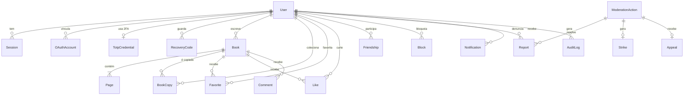

# 02 — Planejamento do back-end

> Planejamento técnico do servidor do quillframe: arquitetura, banco de dados, API, regras de negócio, **segurança**, moderação e privacidade. Parte das regras do livro definidas no [documento 01](01-referencia-livro-minecraft-stendhal.md). A interface está no [documento 03](03-frontend.md).
>
> **Idioma:** este documento, os comentários do código e os commits são em português. Os identificadores do código (tabelas, campos, rotas) são em inglês. Tudo o que o usuário do site vê (mensagens de erro, e-mails, páginas) é em **inglês** e aparece aqui entre aspas.
>
> Legenda:
> - **[confirmado]**: verificado em fonte (norma, documentação oficial ou texto de lei).
> - **[proposta]**: escolha deste planejamento. Pode mudar sem afetar o resto.
> - **[a validar]**: depende de conferir algo antes de virar regra (interpretação de lei, limite de plano gratuito, comportamento do jogo).

---

## Resumo

- **Stack:** Node.js 24 LTS + TypeScript, Fastify, Prisma e PostgreSQL, num monorepo pnpm. O front e o back compartilham o parser `§`, o motor de quebra de linha e as validações.
- **Mesma origem:** o Fastify serve a SPA e a API (`/api`) no mesmo domínio. Isso permite cookies `SameSite` e CSP estrita, sem precisar de CORS.
- **Senhas:** Argon2id com pepper guardado fora do banco, mínimo de 15 caracteres e bloqueio de senhas que já vazaram (HaveIBeenPwned). Um dump do banco não revela senhas nem sessões.
- **Sessões:** token aleatório num cookie `HttpOnly`, guardado no banco só como hash. Nada de JWT no `localStorage`.
- **Login:** e-mail + senha, Google e Discord. O 2FA (TOTP) é opcional para usuários e obrigatório para moderadores.
- **Público 16+**, por causa do ECA Digital (Lei 15.211/2025). Usuários de 16 e 17 anos ficam com as proteções ligadas por padrão.
- **Comunidade segura por desenho:** sem mensagens privadas, sem comentários de texto livre e sem upload de imagens. Toda publicação passa por um filtro e pode ser denunciada.

---

## 1. Arquitetura

### 1.1 O que o back-end faz
- **Contas:** cadastro, login (senha, Google, Discord), 2FA e sessões.
- **Biblioteca:** rascunhos com autosave, assinatura, publicação, importação e exportação `.stendhal`.
- **Rede social:** amizades, bloqueios, likes, favoritos, comentários predefinidos, cópias, feed, busca e notificações.
- **Moderação:** filtro automático, denúncias, fila de revisão, sanções e recursos.
- **Privacidade:** exportação e exclusão de dados, retenção e auditoria.

### 1.2 Visão geral

```
 Navegador (SPA React, documento 03)
        │  HTTPS, mesma origem (ex.: quillframe.com.br)
        ▼
 Cloudflare: DNS, TLS, proteção contra DDoS, Turnstile      (com domínio próprio)
        │
        ▼
 Render: Node.js + Fastify
   ├── /                         → SPA compilada (arquivos estáticos)
   ├── /api/*                    → API REST (JSON)
   └── /.well-known/security.txt → contato para relatar falhas
        │                   │                    │
        ▼                   ▼                    ▼
   PostgreSQL            Redis               Resend
   (Neon)                (Upstash)           (e-mails)
                         rate limit

 GitHub Actions: CI, deploy e jobs diários (limpeza, expurgo, backup)
```

### 1.3 Estrutura do repositório

```
quillframe/
├── apps/
│   ├── api/              Fastify + Prisma (este documento)
│   └── web/              React + Vite (documento 03)
├── packages/
│   └── shared/           código dos dois lados: parser §, motor de quebra de linha,
│                         larguras dos glifos, parser/gerador .stendhal,
│                         schemas zod, constantes (1024, 100, 64...) e presets
├── assets/pack/          texturas, fonte e sons (documento 01, D6)
├── docs/
├── docker-compose.yml    Postgres + Redis + Mailpit para desenvolvimento
└── .github/workflows/    CI, deploy e jobs agendados
```

Com o `packages/shared`, **o servidor valida com o mesmo código que o editor usa**. Se o front aceita uma página, o back também aceita, e vice-versa.

### 1.4 Bibliotecas [proposta]

| Função | Biblioteca |
|---|---|
| Servidor HTTP | `fastify` |
| Validação e tipos | `zod` + `fastify-type-provider-zod` |
| Banco | `prisma` (PostgreSQL) |
| Hash de senha | `argon2` (node-argon2) |
| Cookies, headers, rate limit, arquivos estáticos | `@fastify/cookie`, `@fastify/helmet`, `@fastify/rate-limit`, `@fastify/static` |
| OAuth (Google, Discord) | `arctic` |
| TOTP | `otpauth` |
| Redis | `ioredis` (o Upstash aceita o protocolo Redis) |
| E-mail | `resend` |
| Logs | `pino` (já vem no Fastify) |
| Erros em produção | `@sentry/node` |
| Testes | `vitest` |

### 1.5 Hospedagem gratuita

| Peça | Serviço | Observação |
|---|---|---|
| API + SPA | Render (web service gratuito) | Hiberna sem uso, e a primeira requisição depois disso demora. **[a validar]** limites atuais |
| Banco | Neon (PostgreSQL gratuito) | O Postgres gratuito do Render expira, por isso o Neon. **[a validar]** limites atuais |
| Rate limit | Upstash Redis (gratuito) | Os contadores sobrevivem à hibernação do Render |
| E-mail | Resend (gratuito) | Só envia para qualquer endereço com **domínio próprio verificado** |
| DNS, TLS, DDoS, CAPTCHA | Cloudflare (gratuito) | Exige domínio próprio |
| Domínio | registro.br ou outro registrador | **Único custo**, aprovado (B9): um `.com.br` sai por volta de R$ 40/ano |
| Monitoramento | Sentry e UptimeRobot (gratuitos) | |
| CI/CD e jobs | GitHub Actions | |

O domínio próprio é necessário porque, sem ele, o site até funciona no subdomínio do Render, mas **não dá para enviar os e-mails de verificação e de recuperação de senha** para qualquer usuário (B9).

---

## 2. Modelo de dados

### 2.1 Onde está o que você pediu

| Pedido | Tabelas |
|---|---|
| Usuário com login e senha | `User`, `Session`, `OAuthAccount`, `TotpCredential`, `RecoveryCode`, `EmailToken` |
| Aba de amizade | `Friendship`, `Block` |
| Livros favoritos | `Favorite` |
| Livros criados | `Book` (dono = `ownerId`) e `Page` |
| Rede social | `Like`, `Comment`, `BookCopy`, `Notification` |
| Denúncias e moderação | `Report`, `ModerationAction`, `Strike`, `Appeal`, `ConcernNotice` |
| Segurança e auditoria | `AuditLog`, `PendingLogin` |

### 2.2 Diagrama



### 2.3 Enums

| Enum | Valores |
|---|---|
| `Role` | `USER`, `MODERATOR`, `ADMIN` |
| `AccountStatus` | `ACTIVE`, `SUSPENDED`, `BANNED`, `PENDING_DELETION` |
| `BookStatus` | `DRAFT` (Livro e Pena), `SIGNED` (Livro Escrito) |
| `Visibility` | `PRIVATE`, `FRIENDS`, `PUBLIC` |
| `ReviewState` | `NONE`, `PENDING_REVIEW`, `HIDDEN`, `REMOVED` |
| `FriendshipStatus` | `PENDING`, `ACCEPTED` |
| `TokenPurpose` | `EMAIL_VERIFY`, `PASSWORD_RESET`, `EMAIL_CHANGE` |
| `OAuthProvider` | `GOOGLE`, `DISCORD` |
| `ReportTarget` | `BOOK`, `USER` |
| `ReportReason` | `SEXUAL_CONTENT`, `MINOR_SAFETY`, `UNDERAGE_USER`, `HATE`, `HARASSMENT`, `VIOLENCE`, `SELF_HARM`, `PERSONAL_INFO`, `SPAM`, `COPYRIGHT`, `IMPERSONATION`, `OTHER` |
| `ReportStatus` | `OPEN`, `ACTIONED`, `DISMISSED` |
| `ModActionType` | `DISMISS`, `HIDE`, `RESTORE`, `REMOVE`, `WARN`, `STRIKE`, `SUSPEND`, `BAN`, `UNBAN` |
| `AppealStatus` | `OPEN`, `UPHELD`, `REVERSED` |

### 2.4 Schema (rascunho Prisma) [proposta]

```prisma
// Rascunho do schema. As relações (@relation) foram omitidas para facilitar a leitura.

model User {
  id                  String        @id @default(uuid())
  username            String        @unique  // 3–16 caracteres [A-Za-z0-9_], como no Minecraft. É o "autor"
  usernameLower       String        @unique  // unicidade sem diferenciar maiúsculas
  email               String        @unique  // guardado em minúsculas
  emailVerifiedAt     DateTime?
  passwordHash        String?                // null = conta só com Google/Discord
  pepperVersion       Int?                   // versão do pepper usada no hash
  birthDate           DateTime      @db.Date
  role                Role          @default(USER)
  status              AccountStatus @default(ACTIVE)
  suspendedUntil      DateTime?
  avatarId            Int           @default(0) // avatar pré-definido (não há upload)
  bio                 String?       @db.VarChar(160)
  termsVersion        String
  termsAcceptedAt     DateTime
  deletionRequestedAt DateTime?
  createdAt           DateTime      @default(now())
  updatedAt           DateTime      @updatedAt
}

model Session {
  id            String    @id        // SHA-256 do token. O token em si só existe no cookie
  userId        String
  createdAt     DateTime  @default(now())
  lastSeenAt    DateTime  @default(now())
  idleExpiresAt DateTime             // renovado com o uso (7 dias)
  expiresAt     DateTime             // limite absoluto (30 dias)
  reauthAt      DateTime?            // último step-up (senha ou 2FA)
  ip            String?
  userAgent     String?   @db.VarChar(256)
  @@index([userId])
}

model PendingLogin {                 // senha correta, falta o código 2FA
  id        String   @id             // SHA-256 do token do cookie __Host-qf_mfa
  userId    String
  attempts  Int      @default(0)
  expiresAt DateTime                 // 5 minutos
}

model OAuthAccount {
  provider       OAuthProvider
  providerUserId String
  userId         String
  createdAt      DateTime @default(now())
  @@id([provider, providerUserId])
  @@unique([userId, provider])
}

model EmailToken {
  id        String       @id @default(uuid())
  userId    String
  purpose   TokenPurpose
  tokenHash String       @unique     // SHA-256 do token enviado no link
  newEmail  String?                  // só em EMAIL_CHANGE
  expiresAt DateTime
  usedAt    DateTime?
  createdAt DateTime     @default(now())
}

model TotpCredential {
  userId       String    @id
  secretEnc    Bytes                 // AES-256-GCM: iv + texto cifrado + tag
  keyVersion   Int
  lastUsedStep BigInt    @default(0) // impede reutilizar o mesmo código
  enabledAt    DateTime?             // null enquanto a configuração não foi confirmada
}

model RecoveryCode {
  id       String    @id @default(uuid())
  userId   String
  codeHash String                    // SHA-256 (o código tem 80 bits aleatórios)
  usedAt   DateTime?
}

model Book {
  id            String      @id @default(uuid())
  ownerId       String
  title         String      @default("") @db.VarChar(64)
  status        BookStatus  @default(DRAFT)
  visibility    Visibility  @default(PRIVATE) // CHECK: DRAFT ⇒ PRIVATE
  reviewState   ReviewState @default(NONE)
  allowCopies   Boolean     @default(true)
  allowComments Boolean     @default(true)
  pageCount     Int         @default(1)
  version       Int         @default(0)       // concorrência otimista do autosave
  likeCount     Int         @default(0)       // contadores desnormalizados
  favoriteCount Int         @default(0)
  signedAt      DateTime?
  publishedAt   DateTime?
  deletedAt     DateTime?
  createdAt     DateTime    @default(now())
  updatedAt     DateTime    @updatedAt
  @@index([ownerId, updatedAt])
  @@index([visibility, reviewState, publishedAt])
}

model Page {
  bookId  String
  index   Int                        // começa em 0
  content String  @default("")       // texto bruto com os códigos §, até 1024 (D2)
  @@id([bookId, index])
}

model BookCopy {                     // "Make a copy": aponta para o original, que é imutável
  id           String   @id @default(uuid())
  ownerId      String                // quem fez a cópia
  sourceBookId String                // sempre o livro original (geração 0)
  generation   Int                   // 1 = cópia do original, 2 = cópia da cópia
  createdAt    DateTime @default(now())
  @@unique([ownerId, sourceBookId, generation])
}

model Favorite {
  userId    String
  bookId    String
  createdAt DateTime @default(now())
  @@id([userId, bookId])
}

model Like {
  userId    String
  bookId    String
  createdAt DateTime @default(now())
  @@id([userId, bookId])
}

model Comment {                      // só comentários predefinidos, sem texto livre
  id        String   @id @default(uuid())
  bookId    String
  authorId  String
  presetId  Int                      // lista fixa em packages/shared
  createdAt DateTime @default(now())
  @@unique([bookId, authorId, presetId])
}

model Friendship {                   // par em ordem canônica: userAId < userBId
  userAId     String
  userBId     String
  requestedBy String
  status      FriendshipStatus @default(PENDING)
  createdAt   DateTime         @default(now())
  acceptedAt  DateTime?
  @@id([userAId, userBId])
}

model Block {
  blockerId String
  blockedId String
  createdAt DateTime @default(now())
  @@id([blockerId, blockedId])
}

model Report {
  id         String       @id @default(uuid())
  reporterId String
  targetType ReportTarget
  targetId   String                  // id do livro ou do usuário
  pageIndex  Int?
  reason     ReportReason
  details    String?      @db.VarChar(500) // só moderadores leem
  status     ReportStatus @default(OPEN)
  actionId   String?                 // ação de moderação que resolveu
  createdAt  DateTime     @default(now())
  resolvedAt DateTime?
  @@unique([reporterId, targetType, targetId])
  @@index([status, reason, createdAt])
}

model ModerationAction {
  id          String        @id @default(uuid())
  moderatorId String?                // null = ação automática
  targetType  ReportTarget
  targetId    String
  type        ModActionType
  guideline   String?                // regra violada, ex.: "1-sexual-content"
  reason      String        @db.VarChar(1000) // obrigatório; enviado ao usuário
  automated   Boolean       @default(false)   // ECA Digital, art. 30
  createdAt   DateTime      @default(now())
}

model Strike {
  id        String   @id @default(uuid())
  userId    String
  actionId  String   @unique
  expiresAt DateTime                 // vale 90 dias
}

model Appeal {
  id         String       @id @default(uuid())
  userId     String
  actionId   String       @unique    // um recurso por decisão
  message    String       @db.VarChar(1000)
  status     AppealStatus @default(OPEN)
  reviewerId String?
  createdAt  DateTime     @default(now())
  decidedAt  DateTime?
}

model ConcernNotice {                // canal público do ECA Digital, art. 29 (sem conta, mas identificado)
  id          String       @id @default(uuid())
  name        String       @db.VarChar(120)
  email       String
  relation    String                 // vítima, responsável, Ministério Público, entidade...
  contentUrl  String       @db.VarChar(300)
  description String       @db.VarChar(2000)
  confirmedAt DateTime?              // e-mail confirmado
  status      ReportStatus @default(OPEN)
  createdAt   DateTime     @default(now())
}

model Notification {
  id        String    @id @default(uuid())
  userId    String
  type      String                   // FRIEND_REQUEST, BOOK_LIKED, MOD_DECISION, SECURITY_ALERT...
  payload   Json
  readAt    DateTime?
  createdAt DateTime  @default(now())
  @@index([userId, readAt, createdAt])
}

model AuditLog {
  id        BigInt   @id @default(autoincrement())
  actorId   String?
  event     String                   // LOGIN_FAILED, PASSWORD_CHANGED, BOOK_REMOVED...
  targetId  String?
  ip        String?
  userAgent String?
  meta      Json?
  createdAt DateTime @default(now())
  @@index([actorId, createdAt])
  @@index([event, createdAt])
}
```

### 2.5 Regras de integridade
- **IDs UUID, não sequenciais.** Ninguém descobre quantos livros existem nem tenta o "próximo id". A proteção de verdade continua sendo a autorização (5.9).
- **CHECKs** (SQL escrito na migration, porque o Prisma não gera): `status = 'DRAFT'` exige `visibility = 'PRIVATE'`; `generation IN (1, 2)`; `char_length(content) <= 1024` como rede de segurança.
- **Trigger que impede alterar páginas de livro assinado.** A D7 (assinar trava) fica garantida no banco, além da API.
- Contadores (`likeCount`, `favoriteCount`, `pageCount`) são atualizados na mesma transação da ação.
- Livros e contas usam exclusão lógica (`deletedAt`, `PENDING_DELETION`). Um job apaga de vez depois do prazo (7.5).
- Limites: até **1000 páginas** por livro e 200 rascunhos por usuário **[proposta]**. A D3 permite passar de 100 páginas; o limite rígido só evita abuso.
- Contagem de caracteres da página igual à do Java, que conta unidades UTF-16 (`String.length()`). Assim, um emoji como `💔` conta 2 **[confirmado]** (documento 04, §4). A função fica no `packages/shared` e é a mesma no front e no back.
- Limite de linhas: até 14, sem contar a linha vazia depois de um `\n` final, como no editor da 1.21.x em que os livros do autor foram escritos (documento 04, §4).

---

## 3. Regras de negócio

### 3.1 Ciclo de vida do livro

```
        Create / Import
              │
              ▼
      ┌───────────────┐   autosave (PUT da página)
      │     DRAFT     │◄─────────────────┐
      │  (sempre      │──────────────────┘
      │   privado)    │
      └───────┬───────┘
              │ Sign {title, visibility}      irreversível (D7)
              ▼
      ┌───────────────┐   visibility: PRIVATE ⇄ FRIENDS ⇄ PUBLIC
      │    SIGNED     │   (o conteúdo nunca mais muda)
      └───────┬───────┘
              │ moderação
              ▼
   reviewState: NONE → PENDING_REVIEW → HIDDEN → REMOVED
                  ▲            │           │
                  └────────────┴───────────┘  (aprovado / restaurado)
```

### 3.2 Quem vê o quê

| Estado do livro | Dono | Amigo | Outro usuário | Visitante sem conta | Moderador |
|---|---|---|---|---|---|
| `DRAFT` | lê e edita | — | — | — | — |
| `SIGNED` + `PRIVATE` | lê | — | — | — | — |
| `SIGNED` + `FRIENDS` | lê | lê | — | — | só se denunciado |
| `SIGNED` + `PUBLIC` | lê | lê | lê | lê | lê |
| `PENDING_REVIEW` | lê, com aviso | — | — | — | lê |
| `HIDDEN` ou `REMOVED` | vê o aviso e o motivo | — | — | — | lê |

- Se um usuário bloqueou o outro, nenhum dos dois vê o conteúdo do outro (livros, perfil, comentários).
- Moderadores **nunca** leem rascunhos nem livros privados.
- O que alguém não pode ver responde **404**, nunca 403, para não confirmar que o recurso existe.

### 3.3 Autosave
1. O editor espera cerca de 1,5 s sem digitação (documento 03) e envia só a página alterada: `PUT /api/books/:id/pages/:index` com `{ content, baseVersion }`.
2. Numa transação, o servidor confere o dono, o status `DRAFT` e se `baseVersion` é igual a `version`. Depois valida o conteúdo (com o `packages/shared`), salva, incrementa `version` e devolve a versão nova.
3. Se a versão for diferente (outra aba ou outro aparelho salvou antes), responde 409 `VERSION_CONFLICT` com a versão atual. O front pergunta o que fazer.
4. Adicionar e remover páginas (`POST /pages`, `DELETE /pages/:index`) segue a mesma regra de versão. Os índices das páginas seguintes são ajustados na mesma transação.
5. Limpeza do conteúdo: `\r\n` vira `\n`; caracteres de controle somem (menos o `\n`); somem também os caracteres invisíveis de direção de texto (U+202A–U+202E, U+2066–U+2069), usados para disfarçar texto. **Todos os códigos `§` ficam como estão, inclusive os inválidos** (`§ `, `§§`), porque a arte do autor depende deles (documento 01, §6).
6. Linhas além da 14ª são aceitas, já que o jogo só não as mostra. O editor avisa.

### 3.4 Assinatura e publicação
`POST /api/books/:id/sign` com `{ title, visibility, acceptGuidelines }`:
- Só o dono assina, e só um `DRAFT`. É irreversível (D7).
- O título tem de 1 a 64 caracteres, passa por `trim` e NFC e não aceita caracteres de controle. O autor é o username (D4).
- `visibility = PRIVATE`: só assina.
- `FRIENDS` ou `PUBLIC`: exige `acceptGuidelines: true` e e-mail verificado, e o livro passa pelo filtro (6.2).
- Se o filtro acusar algo, o livro fica `PENDING_REVIEW`: só o autor o vê, com um aviso, até um moderador aprovar.

Depois de assinado, o dono pode mudar a visibilidade (`PATCH /api/books/:id/visibility`), nunca o conteúdo. Ao sair de `PRIVATE` pela primeira vez, o filtro roda de novo.

Contas com menos de 72 horas publicam normalmente, mas os livros delas não aparecem em "New" e "Trending" até a conta completar 72 horas. Continuam acessíveis pelo perfil e pelo link. Isso atrapalha bots de spam **[proposta]**.

### 3.5 Cópias ("Make a copy")
Aplica as gerações do documento 01, §1:
- Dá para copiar um livro assinado que você pode ver, com `allowCopies = true`, de geração 0 ou 1. Cópia da cópia não pode ser copiada, como no jogo.
- A cópia não duplica o conteúdo: aponta para o original (`BookCopy`). O autor exibido é sempre o original, e a geração aparece na tela ("Copy of original", "Copy of a copy").
- Se o original ficar privado, oculto ou removido, as cópias mostram "This book is no longer available.". Assim, a moderação tira um livro de todos os lugares de uma vez.
- Cada usuário tem no máximo uma cópia por geração de cada livro.

### 3.6 Importação e exportação `.stendhal`
- **Importar:** `POST /api/books/import` com o texto do arquivo (até 2 MB, UTF-8 estrito). O parser do `packages/shared` (documento 01, §7) valida o cabeçalho, as páginas e os limites. O resultado é um **rascunho** de quem importou. A linha `author:` é ignorada, porque o autor é sempre a conta (D4). Títulos acima de 64 caracteres são cortados.
- **Exportar:** `GET /api/books/:id/export` gera o arquivo no mesmo formato. **Só o dono exporta** (B13): o livro de outra pessoa nunca vira arquivo. Quem quiser guardar o livro de alguém usa "Make a copy", que mantém o autor original e some se o original sair do ar.
- O nome do arquivo vem do título, só com `[a-z0-9_-]`. Isso impede injeção no header `Content-Disposition`.

### 3.7 Rede social
- **Amizade:** pedido, depois aceitar ou recusar. O par é guardado em ordem canônica (uma linha por par). Não funciona se um dos dois bloqueou o outro. Máximo de 50 pedidos pendentes enviados **[proposta]**.
- **Bloqueio:** desfaz a amizade e os pedidos, esconde o conteúdo dos dois lados e impede qualquer interação (like, comentário, cópia, pedido).
- **Likes e favoritos:** idempotentes (`PUT` adiciona, `DELETE` remove), só em livros que você pode ver. A lista de favoritos é privada por padrão, com opção de mostrar no perfil.
- **Comentários predefinidos:** o usuário escolhe de uma lista fixa (documento 03, §6). Cada preset vale uma vez por livro por usuário. O dono pode remover comentários do próprio livro ou desligá-los. Sem texto livre, não há ofensas, links de spam nem conversas de aliciamento.
- **Feed:** "New" (por `publishedAt`), "Trending" (likes dos últimos 7 dias, com decaimento no tempo) e "Friends" (livros de amigos). Exclui usuários bloqueados, livros em revisão e contas novas (3.4). Paginação por cursor.
- **Busca:** títulos e usernames com `pg_trgm` (similaridade), mínimo de 2 caracteres, com rate limit. Usuários de 16 e 17 anos não aparecem na busca de usuários (7.3). Busca dentro do texto dos livros fica para o futuro.
- **Notificações:** geradas por eventos (pedido de amizade, aceite, like, comentário, decisão de moderação, alerta de segurança). Likes são agrupados ("3 people liked..."). O front consulta a cada 60 s; não há WebSocket na v1, por ser mais simples e caber no plano gratuito **[proposta]**.

---

## 4. API REST

### 4.1 Convenções
- Base `/api`, JSON, campos em camelCase.
- Autenticação pelo cookie de sessão. Toda mutação (`POST`, `PUT`, `PATCH`, `DELETE`) exige o header `X-CSRF-Token` (5.4) e `Content-Type: application/json`.
- Paginação: `?cursor=...&limit=...` (`limit` até 50), resposta `{ items, nextCursor }`.
- `Cache-Control: no-store` em todas as respostas da API.
- Erros no formato **RFC 9457** (`application/problem+json`): `{ type, title, status, detail, code }`. O `code` é estável, para o front decidir o que fazer. O `detail` é a mensagem em inglês exibida ao usuário.

| `code` | Status | Quando |
|---|---|---|
| `VALIDATION_FAILED` | 400 | corpo inválido (com a lista de campos) |
| `UNAUTHENTICATED` | 401 | sem sessão ou sessão expirada |
| `INVALID_CREDENTIALS` | 401 | login falhou ("Invalid email or password.") |
| `MFA_REQUIRED` | 401 | senha certa; falta o código 2FA |
| `REAUTH_REQUIRED` | 403 | ação sensível sem confirmação recente (step-up) |
| `CAPTCHA_REQUIRED` | 403 | o front precisa mostrar o Turnstile |
| `EMAIL_NOT_VERIFIED` | 403 | publicar ou interagir sem e-mail verificado |
| `ACCOUNT_SUSPENDED` | 403 | conta suspensa (com a data de fim) |
| `NOT_FOUND` | 404 | não existe **ou** você não pode ver |
| `VERSION_CONFLICT` | 409 | autosave com versão antiga |
| `BOOK_SIGNED` | 409 | tentativa de editar livro assinado |
| `PAYLOAD_TOO_LARGE` | 413 | corpo acima do limite |
| `BREACHED_PASSWORD` | 422 | senha encontrada em vazamentos |
| `RATE_LIMITED` | 429 | com o header `Retry-After` |

### 4.2 Endpoints
Acesso: 🔓 público · 🔑 logado · 🔐 logado + step-up recente · 🛡️ moderador · 👑 admin.

**Autenticação**

| Método | Rota | Acesso | Observação |
|---|---|---|---|
| POST | `/api/auth/register` | 🔓 | `{username, email, password, birthDate, acceptTerms, turnstileToken}`; sempre responde 202 |
| POST | `/api/auth/verify-email` | 🔓 | `{token}` |
| POST | `/api/auth/resend-verification` | 🔓 | sempre 202 |
| POST | `/api/auth/login` | 🔓 | `{email, password, turnstileToken?}` |
| POST | `/api/auth/login/mfa` | 🔓 | `{code}` ou `{recoveryCode}`, com o cookie de login pendente |
| POST | `/api/auth/logout` | 🔑 | encerra a sessão atual |
| POST | `/api/auth/forgot-password` | 🔓 | sempre 202 |
| POST | `/api/auth/reset-password` | 🔓 | `{token, newPassword}` |
| GET | `/api/auth/oauth/:provider/start` | 🔓 | `provider` = `google` ou `discord`; redireciona |
| GET | `/api/auth/oauth/:provider/callback` | 🔓 | volta do provedor |
| POST | `/api/auth/oauth/complete` | 🔓 | onboarding de conta nova: `{username, birthDate, acceptTerms}` |
| POST | `/api/auth/reauth` | 🔑 | step-up: `{password}` ou `{code}` |
| GET | `/api/auth/csrf` | 🔓 | entrega o token CSRF antes do login |

**Conta**

| Método | Rota | Acesso | Observação |
|---|---|---|---|
| GET | `/api/me` | 🔑 | perfil, papel, flags (e-mail verificado, 2FA, menor de 18) |
| PATCH | `/api/me/profile` | 🔑 | `{bio?, avatarId?}` |
| PATCH | `/api/me/privacy` | 🔑 | travado para 16–17 anos (7.3) |
| POST | `/api/me/password` | 🔐 | `{currentPassword, newPassword}` |
| POST | `/api/me/email` | 🔐 | `{newEmail}`; confirma pelo novo e-mail |
| GET | `/api/me/sessions` | 🔑 | lista de dispositivos |
| DELETE | `/api/me/sessions/:id` | 🔑 | encerra uma sessão |
| DELETE | `/api/me/sessions` | 🔑 | "Sign out everywhere" (menos a atual) |
| POST | `/api/me/mfa/totp/setup` | 🔐 | devolve a URI `otpauth://` uma única vez |
| POST | `/api/me/mfa/totp/enable` | 🔐 | `{code}`; devolve os códigos de recuperação uma única vez |
| DELETE | `/api/me/mfa/totp` | 🔐 | desativa (exige também um código atual) |
| POST | `/api/me/mfa/recovery-codes` | 🔐 | gera novos códigos e invalida os antigos |
| GET | `/api/me/oauth` | 🔑 | contas vinculadas |
| DELETE | `/api/me/oauth/:provider` | 🔐 | só se sobrar outro jeito de entrar |
| GET | `/api/me/security-events` | 🔑 | atividade recente de segurança |
| GET | `/api/me/export` | 🔐 | ZIP com JSON + `.stendhal` (1 por dia) |
| DELETE | `/api/me` | 🔐 | pede a exclusão da conta (7.5) |
| POST | `/api/me/restore` | 🔑 | cancela a exclusão dentro de 30 dias |

**Livros**

| Método | Rota | Acesso | Observação |
|---|---|---|---|
| GET | `/api/me/books?status=draft\|signed` | 🔑 | biblioteca do usuário |
| GET | `/api/me/copies` | 🔑 | cópias colecionadas |
| POST | `/api/books` | 🔑 | cria um rascunho vazio |
| POST | `/api/books/import` | 🔑 | texto `.stendhal` (até 2 MB) |
| GET | `/api/books/:id` | 🔓 | metadados + páginas, se a matriz 3.2 permitir |
| PATCH | `/api/books/:id` | 🔑 | dono: título (só rascunho), `allowCopies`, `allowComments` |
| PUT | `/api/books/:id/pages/:index` | 🔑 | autosave: `{content, baseVersion}` |
| POST | `/api/books/:id/pages` | 🔑 | `{index, baseVersion}` insere página |
| DELETE | `/api/books/:id/pages/:index` | 🔑 | `{baseVersion}` remove página |
| POST | `/api/books/:id/sign` | 🔑 | `{title, visibility, acceptGuidelines}` |
| PATCH | `/api/books/:id/visibility` | 🔑 | só livro assinado |
| DELETE | `/api/books/:id` | 🔑 | dono |
| GET | `/api/books/:id/export` | 🔑 | `.stendhal`, só para o dono (3.6) |
| POST | `/api/books/:id/copy` | 🔑 | cria a cópia (3.5) |

**Social**

| Método | Rota | Acesso | Observação |
|---|---|---|---|
| GET | `/api/users/:username` | 🔓 | perfil público (respeita bloqueios e privacidade) |
| GET | `/api/users/:username/books` | 🔓 | livros visíveis para quem pergunta |
| PUT / DELETE | `/api/books/:id/like` | 🔑 | |
| PUT / DELETE | `/api/books/:id/favorite` | 🔑 | |
| GET | `/api/me/favorites` | 🔑 | |
| GET | `/api/books/:id/comments` | 🔓 | contagem por preset e quem comentou |
| PUT / DELETE | `/api/books/:id/comments/:presetId` | 🔑 | marca ou desmarca um preset |
| DELETE | `/api/comments/:id` | 🔑 | autor do comentário ou dono do livro |
| GET | `/api/me/friends` | 🔑 | |
| GET | `/api/me/friend-requests` | 🔑 | recebidos e enviados |
| POST | `/api/friend-requests` | 🔑 | `{username}` |
| POST | `/api/friend-requests/:userId/accept` | 🔑 | |
| POST | `/api/friend-requests/:userId/decline` | 🔑 | |
| DELETE | `/api/friends/:username` | 🔑 | desfaz a amizade |
| GET | `/api/me/blocks` | 🔑 | |
| PUT / DELETE | `/api/blocks/:username` | 🔑 | |
| GET | `/api/feed?tab=new\|trending\|friends` | 🔓 | `friends` exige login |
| GET | `/api/search?q=` | 🔓 | livros e usuários |
| GET | `/api/me/notifications` | 🔑 | |
| POST | `/api/me/notifications/read` | 🔑 | `{ids}` ou todas |

**Denúncias e moderação**

| Método | Rota | Acesso | Observação |
|---|---|---|---|
| POST | `/api/reports` | 🔑 | `{targetType, targetId, reason, pageIndex?, details?}` |
| GET | `/api/me/reports` | 🔑 | situação das minhas denúncias |
| GET | `/api/me/moderation` | 🔑 | avisos, strikes e decisões sobre mim |
| POST | `/api/appeals` | 🔑 | `{actionId, message}` |
| POST | `/api/concerns` | 🔓 | canal público (6.9), com Turnstile |
| POST | `/api/concerns/confirm` | 🔓 | confirmação por e-mail |
| GET | `/api/mod/queue` | 🛡️ | fila priorizada |
| GET | `/api/mod/reports/:id` | 🛡️ | detalhe + histórico do autor |
| POST | `/api/mod/actions` | 🛡️ | `{targetType, targetId, type, guideline, reason, reportIds}`; `BAN` exige step-up |
| GET | `/api/mod/appeals` | 🛡️ | |
| POST | `/api/mod/appeals/:id/decide` | 🛡️ | `{status, reason}` |
| GET | `/api/mod/concerns` | 🛡️ | notificações do canal público |
| GET | `/api/admin/audit` | 👑 | auditoria |
| PATCH | `/api/admin/users/:id/role` | 👑 | exige step-up; revoga as sessões da pessoa |

**Sistema**

| Método | Rota | Acesso | Observação |
|---|---|---|---|
| GET | `/api/health` | 🔓 | confere o banco; usado pelo monitoramento |
| GET | `/.well-known/security.txt` | 🔓 | contato para relatar vulnerabilidades |

Não há endpoints internos para jobs: eles rodam como scripts no GitHub Actions (8.4).

---

## 5. Segurança

### 5.1 Princípios
- **Defesa em profundidade:** cada ataque encontra mais de uma barreira. Exemplo: o livro assinado é travado na API **e** no banco.
- **Seguro por padrão:** livros nascem privados, cookies nascem `HttpOnly` e adolescentes nascem protegidos.
- **Menor privilégio:** o usuário do banco usado pela aplicação não altera tabelas, e o moderador não lê rascunhos.
- **Falhar fechado:** na dúvida (erro ao checar permissão, token inválido), a resposta é negar.
- **Nunca confiar no cliente:** o front valida para ajudar o usuário; o servidor valida para proteger o sistema.
- **Guardar o mínimo:** dado que não existe não vaza.

### 5.2 Senhas: a prioridade do projeto

Uma senha pode vazar de quatro jeitos. O sistema se defende de cada um:

| Como vaza | Exemplo | Defesas |
|---|---|---|
| 1. Do nosso banco | backup exposto, SQL injection, credencial do banco roubada | Argon2id + pepper; nenhuma senha em texto; tokens só como hash |
| 2. No caminho | Wi-Fi público, logs, e-mails, URL | HTTPS + HSTS; senha só no corpo do POST; logs com redação; nenhum e-mail contém senha |
| 3. De outro site | o usuário reutiliza uma senha que vazou em outro serviço (credential stuffing) | bloqueio de senhas vazadas; rate limit; Turnstile; 2FA; alerta de novo login |
| 4. Pelo próprio usuário | phishing (página falsa de login) | 2FA; DMARC no domínio de e-mail; passkeys no futuro |

**Política de senha**

| Regra | Valor | Por quê |
|---|---|---|
| Tamanho | **15 a 128** caracteres | O NIST SP 800-63B-4 pede no mínimo 15 quando a senha é o único fator **[confirmado]**. O máximo evita DoS com senhas gigantes |
| Caracteres | qualquer um, inclusive espaço, acento e emoji | Frases-senha ("my cat writes books at night") são longas e fáceis de lembrar |
| Normalização | Unicode NFKC antes do hash | "é" digitado de jeitos diferentes vira a mesma senha (recomendação do NIST) |
| Composição | **não** exige maiúscula, número ou símbolo | Não aumenta a segurança real e leva a senhas previsíveis (NIST) |
| Troca periódica | **não** é exigida | Só quando há indício de vazamento (NIST) |
| Lista de bloqueio | senhas vazadas (HIBP) + palavras do contexto: `quillframe`, `minecraft`, o próprio username e o e-mail | |
| Dicas e perguntas secretas | proibidas | São fáceis de descobrir; o NIST não as aceita **[confirmado]** |
| Colar e gerenciador de senhas | permitidos | Incentivam senhas fortes e únicas |

**Senhas vazadas (HaveIBeenPwned, k-anonimato).** No cadastro e em toda troca de senha, o servidor calcula o SHA-1 da senha e envia **só os 5 primeiros caracteres** desse hash para `api.pwnedpasswords.com/range/`. A comparação com a lista que volta é feita localmente; nem a senha nem o hash completo saem do servidor. O header `Add-Padding: true` esconde o tamanho da resposta. Se a API estiver fora do ar, o cadastro segue e o caso fica registrado **[proposta]**. Mensagem: "This password has appeared in a data breach. Please choose a different one."

**Armazenamento**

```
senha digitada
    │  NFKC
    ▼
Argon2id(senha, salt aleatório de 16 bytes, secret = pepper)     m = 19 MiB, t = 2, p = 1
    │
    ▼
"$argon2id$v=19$m=19456,t=2,p=1$<salt>$<hash>"  +  pepperVersion   → banco
```

- **Argon2id** com os parâmetros mínimos da OWASP (19 MiB de memória, 2 iterações, paralelismo 1) **[confirmado]**. Cada tentativa de adivinhar custa memória e tempo, o que torna ataques com GPU caros. Medir no Render: se o login passar de ~300 ms, manter os parâmetros e nunca baixar do mínimo.
- **Pepper:** 32 bytes aleatórios numa variável de ambiente (`PASSWORD_PEPPER_V1`), passados ao Argon2 como `secret`. Ele não fica no banco nem no repositório. **Quem rouba só o banco não consegue testar senhas offline.** O pepper é versionado: hashes novos usam a versão atual e, no login, um hash com versão antiga é refeito.
- **Rehash no login** quando os parâmetros ou o pepper mudarem (`argon2.needsRehash`).
- **Usuário inexistente:** o servidor verifica a senha contra um hash falso mesmo assim, para o tempo de resposta ser igual. Isso impede descobrir e-mails cadastrados pelo tempo.
- **Concorrência:** cada hash usa 19 MiB. Uma fila limita a 4 hashes simultâneos **[proposta]**, para uma enxurrada de logins não esgotar a memória do Render.

**E se o banco vazar?**

| Dado no dump | O que o atacante consegue | Por quê |
|---|---|---|
| `passwordHash` | nada sem o pepper. Com o pepper, cada palpite ainda custa 19 MiB e dezenas de milissegundos | Argon2id + pepper fora do banco |
| `Session.id` | nada | é o SHA-256 do token; o token só existe no cookie |
| `EmailToken.tokenHash` | nada | só o hash, e expira em minutos |
| `TotpCredential.secretEnc` | nada sem a chave | AES-256-GCM com chave fora do banco |
| `RecoveryCode.codeHash` | nada | 80 bits aleatórios: impossível testar todas as combinações |
| e-mails, datas de nascimento | dados pessoais expostos | não dá para evitar; segue o plano de incidente (5.17) |

**Nunca:**
- registrar senha em log, nem em mensagem de erro;
- enviar senha por e-mail, nem a "senha temporária";
- guardar senha com criptografia reversível;
- colocar senha ou token em query string;
- cortar a senha ou restringir caracteres;
- usar perguntas secretas.

### 5.3 Sessões e cookies

| Cookie | Conteúdo | Atributos | Duração |
|---|---|---|---|
| `__Host-qf_session` | token de sessão (32 bytes aleatórios, base64url) | `HttpOnly`, `Secure`, `SameSite=Lax`, `Path=/` | até 30 dias |
| `__Host-qf_csrf` | token CSRF (HMAC da sessão) | `Secure`, `SameSite=Lax`, `Path=/`, legível pelo JS | igual à sessão |
| `__Host-qf_mfa` | login esperando o código 2FA | `HttpOnly`, `Secure`, `SameSite=Strict`, `Path=/` | 5 min |
| `__Host-qf_oauth` | `state` + `code_verifier` do OAuth | `HttpOnly`, `Secure`, `SameSite=Lax`, `Path=/` | 10 min |

O prefixo `__Host-` obriga o navegador a só aceitar o cookie com `Secure`, sem `Domain` e com `Path=/`. Assim, nenhum subdomínio consegue sobrescrevê-lo **[confirmado]**.

Regras:
- **Sessão nova a cada login**, nunca reaproveitando um id anterior (evita session fixation).
- No banco fica só o **SHA-256 do token**. Com 256 bits aleatórios, um hash rápido basta: não dá para adivinhar.
- Expira com **7 dias sem uso** e, no máximo, **30 dias** depois do login. `lastSeenAt` é atualizado no máximo a cada 5 minutos, para poupar escrita.
- Revogação: troca ou reset de senha encerra **todas** as sessões; ativar ou desativar o 2FA encerra as outras; mudança de papel encerra todas; "Sign out everywhere" encerra as outras.
- Lista de dispositivos: navegador e sistema (lidos do user agent), IP parcialmente mascarado e último acesso.

**Por que não JWT:** um JWT no `localStorage` pode ser lido por qualquer XSS. Além disso, não dá para revogá-lo antes de expirar sem manter uma lista no servidor, que é exatamente o que a sessão já faz. A sessão opaca é revogável na hora e permite a lista de dispositivos.

### 5.4 CSRF
Quatro camadas:
1. Cookie de sessão com `SameSite=Lax`.
2. **Token double-submit assinado:** `__Host-qf_csrf` = HMAC(id da sessão, `CSRF_SECRET`). O front lê o cookie e envia o valor no header `X-CSRF-Token`; o servidor confere se os dois batem e se o HMAC é válido. Antes do login, um token de pré-sessão protege o próprio login e o cadastro.
3. **Fetch Metadata e Origin:** mutações com `Sec-Fetch-Site: cross-site`, ou com `Origin` diferente de `APP_ORIGIN`, são recusadas.
4. **JSON obrigatório:** um formulário HTML de outro site não consegue enviar `application/json` sem preflight de CORS, e o CORS está fechado.

### 5.5 Login, força bruta e enumeração

```
POST /api/auth/login {email, password, turnstileToken?}
  ├─ rate limit (IP, e-mail) estourado        → 429 RATE_LIMITED
  ├─ muitas falhas recentes e sem Turnstile   → 403 CAPTCHA_REQUIRED
  ├─ busca o usuário (ou usa o hash falso)    → verifica o Argon2id
  ├─ senha errada                             → 401 "Invalid email or password."  (+ AuditLog)
  ├─ senha certa, 2FA ativo                   → PendingLogin + cookie __Host-qf_mfa → 401 MFA_REQUIRED
  └─ senha certa, sem 2FA                     → sessão nova + CSRF novo + alerta se o dispositivo for novo
```

- **Login por e-mail**, não por username. O username é público e entregaria metade da credencial **[proposta, B8]**.
- A mesma mensagem para e-mail inexistente, senha errada ou conta sem senha (só Google/Discord).
- **Sem bloqueio permanente da conta**, porque um atacante poderia trancar a vítima de propósito. Em vez disso: atraso progressivo, Turnstile e e-mail de alerta depois de 10 falhas em uma hora.
- **Cadastro:** a resposta é sempre a mesma ("Check your email to continue."). Se o e-mail já existe, o dono recebe "Someone tried to create an account with your email" em vez de a tela revelar isso.
- Disponibilidade de username: ele já é público, então a checagem ao vivo é aceitável, com rate limit.
- Usernames reservados: `admin`, `mod`, `moderator`, `support`, `quillframe`, `mojang`, `minecraft`, `microsoft` e parecidos **[proposta]**.
- **E-mail não verificado:** pode entrar e escrever rascunhos, mas não publica nem interage (likes, comentários, amizades, denúncias).
- **Conta suspensa ou banida:** depois da senha certa, mostra "Your account is suspended until {date}." com o motivo e o link para recurso.

**Rate limits [proposta]**

| Ação | Limite | Chave | Ao estourar |
|---|---|---|---|
| Login | 5/min e 30/h | IP + e-mail | 429; Turnstile após 5 falhas seguidas na conta |
| Login (geral) | 100/h | IP | 429 |
| Código 2FA | 5 por login pendente; 20/h | conta | refazer o login |
| Cadastro | 5/h | IP | 429 (com Turnstile sempre) |
| Esqueci a senha / reenviar verificação | 3/h por e-mail; 10/h por IP | e-mail, IP | mesma resposta 202 |
| Step-up | 5 a cada 15 min | sessão | 429 |
| Autosave | 120/min | usuário | 429 (o front reenvia) |
| Likes, favoritos, comentários | 60/min | usuário | 429 |
| Pedidos de amizade | 30/dia | usuário | 429 |
| Denúncias | 10/h | usuário | 429 |
| Busca | 30/min | IP ou usuário | 429 |
| Exportar dados | 1/dia | usuário | 429 |
| API em geral | 300/min | IP | 429 |

Os contadores ficam no Redis, para não zerarem quando o Render hiberna.

### 5.6 Recuperação de senha, verificação e troca de e-mail
- **Tokens:** 32 bytes aleatórios (256 bits), em base64url, guardados só como SHA-256, de uso único. Validade: reset em **30 min**, verificação em **24 h**, troca de e-mail em **1 h**. Pedir de novo invalida o anterior.
- **O token vai no fragmento da URL** (`/reset-password#token=...`). O fragmento não é enviado ao servidor no GET, não aparece em logs e não vaza pelo `Referer`. A página lê o token, apaga-o da barra de endereço e o envia por POST. De quebra, os antivírus de e-mail que "clicam" nos links não consomem o token.
- **Reset de senha:** encerra todas as sessões e invalida outros tokens de reset; envia "Your password was changed". **Não desativa o 2FA**: o próximo login continua pedindo o código.
- **Troca de e-mail:** exige step-up. A confirmação vai para o e-mail **novo** e um aviso vai para o **antigo**, com instruções caso não tenha sido você.

**E-mails enviados (em inglês)**

| Assunto | Quando |
|---|---|
| "Verify your email" | cadastro e troca de e-mail |
| "Reset your password" | "Forgot password?" |
| "Your password was changed" | troca ou reset de senha |
| "New sign-in to your account" | login num dispositivo novo |
| "Your email was changed" | troca de e-mail (enviado ao endereço antigo) |
| "Two-factor authentication was turned on/off" | ativar ou desativar o 2FA |
| "Someone tried to create an account with your email" | cadastro com e-mail já usado |
| "A moderation decision about your account" | decisões de moderação (6.7) |

Segurança dos e-mails: domínio com **SPF, DKIM e DMARC** (`p=reject`), para ninguém enviar e-mails falsos em nome do quillframe; sem pixel de rastreamento; links só para `APP_ORIGIN`.

### 5.7 Login com Google e Discord (OAuth 2.0)
1. `GET /api/auth/oauth/:provider/start` gera o `state` (32 bytes) e o `code_verifier` (PKCE, S256), guarda os dois no cookie `__Host-qf_oauth` e redireciona para o provedor com o mínimo de escopos (Google: `openid email`; Discord: `identify email`).
2. No callback, o servidor compara o `state` em tempo constante, troca o código usando o `code_verifier` e valida a identidade (Google: `iss`, `aud`, `exp` e `email_verified`; Discord: `verified`). A URI de retorno é exata e registrada no provedor.
3. Decide pelo quadro:

| Situação | O que acontece |
|---|---|
| Identidade já vinculada | entra na conta (com 2FA, se estiver ativo) |
| Usuário logado vinculando em Options | vincula (exige step-up) |
| E-mail igual ao de uma conta existente, sem vínculo | **não vincula sozinho**: pede para entrar com a senha e vincular em Options |
| Identidade nova | onboarding: username, data de nascimento (16+) e aceite dos termos. Só então a conta é criada |
| E-mail não verificado no provedor | recusa |

- **Por que não vincular sozinho:** se um provedor aceitasse e-mail não verificado, alguém criaria lá uma conta com o e-mail da vítima e cairia direto na conta dela no quillframe.
- Só dá para desvincular se sobrar outro jeito de entrar (senha ou outro provedor).
- O 2FA também vale para quem entra pelo Google ou pelo Discord **[proposta]**.

### 5.8 2FA (TOTP) e step-up
**TOTP**
- Padrão RFC 6238: SHA-1, 6 dígitos, 30 s, compatível com Google Authenticator, Aegis, 1Password etc. Aceita ±1 passo de diferença no relógio.
- Segredo de 20 bytes aleatórios, criptografado com AES-256-GCM pela chave `MFA_ENC_KEY_V*` (variável de ambiente, versionada).
- Ativação: o servidor gera o segredo e devolve a URI `otpauth://` **uma única vez**; o front desenha o QR localmente; o 2FA só liga depois de um código correto, e então aparecem os 10 códigos de recuperação, também **uma única vez**.
- **Anti-replay:** `lastUsedStep` impede usar o mesmo código duas vezes.
- **Tentativas:** 5 por login pendente; depois disso, é preciso refazer o login.
- **Códigos de recuperação:** 10 códigos de 80 bits (`XXXX-XXXX-XXXX-XXXX`), guardados como SHA-256, de uso único. Gerar novos invalida os antigos.
- Ativar e desativar envia e-mail. Desativar exige step-up e um código atual.
- **Obrigatório para `MODERATOR` e `ADMIN`:** sem 2FA, o painel `/mod` não abre.
- Perdeu o celular e os códigos: não há recuperação automática. A pessoa fala com o suporte e, depois de confirmar pelo e-mail e esperar 7 dias com avisos na conta, o 2FA é removido **[proposta]**.

**Step-up (confirmar que é você)**
- Ações sensíveis exigem senha ou código 2FA confirmados nos **últimos 10 minutos** (`Session.reauthAt`): trocar senha, trocar e-mail, ligar ou desligar o 2FA, gerar códigos de recuperação, vincular ou desvincular Google/Discord, exportar dados, excluir a conta e, no painel de moderação, banir.
- Sem confirmação recente, a API responde 403 `REAUTH_REQUIRED`; o front abre o modal de confirmação e repete o pedido.

**Futuro:** passkeys (WebAuthn), que resistem a phishing e são incentivadas pelo NIST rev. 4.

### 5.9 Autorização

| Papel | Pode |
|---|---|
| `USER` | tudo sobre os próprios dados; ver o que a matriz 3.2 permite |
| `MODERATOR` | fila de denúncias; ocultar e remover livros; avisos, strikes e suspensões; ver livros denunciados |
| `ADMIN` | tudo do moderador, mais banir, mudar papéis e ver a auditoria |

- Um módulo central (`apps/api/src/authz`) com funções como `canViewBook(viewer, book)` e o filtro Prisma `visibleBooksWhere(viewer)`. **Nenhuma rota consulta livros sem ele.** Isso evita IDOR (trocar o id na URL e ler o livro de outra pessoa).
- O papel é sempre lido do banco pela sessão, nunca de algo enviado na requisição.
- Mudança de papel encerra as sessões da pessoa e vai para a auditoria.
- Bloqueios são checados em toda interação social.
- **Testes de matriz de autorização:** para cada rota, testes automáticos com cada ator (dono, amigo, estranho, bloqueado, visitante, moderador, admin) e cada estado (rascunho, privado, amigos, público, em revisão, removido). Exemplos:

| Rota | Ator | Estado | Esperado |
|---|---|---|---|
| `GET /api/books/:id` | estranho | `DRAFT` | 404 |
| `GET /api/books/:id` | amigo | `SIGNED` + `FRIENDS` | 200 |
| `GET /api/books/:id` | bloqueado | `SIGNED` + `PUBLIC` | 404 |
| `PUT /api/books/:id/pages/0` | dono | `SIGNED` | 409 `BOOK_SIGNED` |
| `PUT /api/books/:id/pages/0` | outro usuário | `DRAFT` | 404 |
| `POST /api/mod/actions` | usuário comum | — | 404 |

### 5.10 Validação de entrada e injeção
- Toda entrada (corpo, parâmetros, query) passa por um schema zod do `packages/shared` com `.strict()`: campos desconhecidos são recusados. Isso impede **mass assignment** (por exemplo, enviar `"role": "ADMIN"` ao atualizar o perfil).
- O Prisma grava só campos listados explicitamente; nunca se espalha `req.body` direto numa consulta.
- **SQL injection:** o Prisma parametriza tudo. `$queryRawUnsafe` e `$executeRawUnsafe` são proibidos por regra de lint; SQL manual só com o template `$queryRaw`.
- Limites de tamanho: corpo de 64 KB por padrão; 2 MB na importação; título 64; bio 160; detalhes da denúncia 500.
- Títulos e bios: NFC, sem caracteres de controle e sem caracteres de direção de texto. O conteúdo das páginas segue o 3.3 (mantém os `§`).
- Usernames só com `[A-Za-z0-9_]` (3 a 16), como no Minecraft. Assim não existem letras de outros alfabetos se passando por latinas (um "а" cirílico imitando um "a").
- Nenhuma regex com backtracking catastrófico (ReDoS). O filtro de conteúdo usa um algoritmo linear (Aho-Corasick).
- **Open redirect:** o parâmetro `returnTo` só aceita caminhos internos (começando com `/`, nunca `//` nem `http`).
- **SSRF:** o servidor nunca acessa URLs enviadas por usuários. Só chama hosts fixos: HIBP, Google, Discord, Resend e Turnstile.

### 5.11 XSS, CSP e headers
- O conteúdo dos livros é **texto bruto**, nunca HTML. O front desenha no canvas ou insere como texto (o React escapa). Nenhuma rota devolve HTML com dados de usuário.
- Headers (via `@fastify/helmet`):

| Header | Valor |
|---|---|
| `Content-Security-Policy` | `default-src 'self'; script-src 'self' https://challenges.cloudflare.com; style-src 'self'; img-src 'self' data: blob:; font-src 'self'; connect-src 'self'; frame-src https://challenges.cloudflare.com; worker-src 'self'; object-src 'none'; base-uri 'none'; form-action 'self'; frame-ancestors 'none'; upgrade-insecure-requests` |
| `Strict-Transport-Security` | `max-age=63072000; includeSubDomains; preload` |
| `X-Content-Type-Options` | `nosniff` |
| `Referrer-Policy` | `strict-origin-when-cross-origin` (e `no-referrer` nas páginas com token) |
| `Permissions-Policy` | `camera=(), microphone=(), geolocation=(), payment=(), usb=()` |
| `Cross-Origin-Opener-Policy` | `same-origin` |
| `Cross-Origin-Resource-Policy` | `same-origin` |

- A CSP não tem `unsafe-inline` nem `unsafe-eval`. Mesmo que um XSS aparecesse, o navegador não executaria script injetado.
- `frame-ancestors 'none'` impede que o site seja aberto dentro de um iframe de outro (clickjacking).

### 5.12 Abuso e disponibilidade
- Rate limits da 5.5, no Redis.
- **Turnstile** sempre no cadastro, no "Forgot password?" e no canal público (6.9); no login, depois de falhas.
- Domínios de e-mail descartáveis bloqueados no cadastro **[proposta]**.
- E-mail verificado para publicar e interagir; contas novas fora dos feeds por 72 h (3.4).
- Postgres com `statement_timeout` de 5 s para o usuário da aplicação, pool de conexões limitado e paginação de no máximo 50.
- Fila de hashes Argon2 (5.2).
- Timeouts no Fastify (`connectionTimeout`, `requestTimeout`) e encerramento gracioso.
- Cloudflare na frente (com domínio) absorve ataques de volume; o modo "Under Attack" fica disponível para emergências.

### 5.13 Segredos, infraestrutura e backups

| Variável | Uso |
|---|---|
| `DATABASE_URL` | conexão da API (usuário `qf_app`, sem permissão de alterar tabelas) |
| `DATABASE_MIGRATION_URL` | usuário `qf_migrate`, só no deploy |
| `REDIS_URL` | rate limit |
| `APP_ORIGIN` | origem do site (checagem de `Origin`, links nos e-mails) |
| `CSRF_SECRET` | HMAC do token CSRF |
| `PASSWORD_PEPPER_V1`, `PASSWORD_PEPPER_CURRENT` | pepper das senhas e versão atual |
| `MFA_ENC_KEY_V1`, `MFA_ENC_KEY_CURRENT` | chave do segredo TOTP e versão atual |
| `GOOGLE_CLIENT_ID`, `GOOGLE_CLIENT_SECRET` | OAuth Google |
| `DISCORD_CLIENT_ID`, `DISCORD_CLIENT_SECRET` | OAuth Discord |
| `RESEND_API_KEY` | e-mail |
| `TURNSTILE_SECRET_KEY` | CAPTCHA |
| `SENTRY_DSN` | erros |

- As variáveis são validadas com zod na inicialização. **A API não sobe** se faltar alguma, ou se o pepper e as chaves tiverem menos de 32 bytes.
- `.env` está no `.gitignore`; o `.env.example` vai sem valores. O **gitleaks** no CI barra commits com segredos.
- Os segredos ficam nos painéis do Render e do GitHub Actions. Pepper e chave do 2FA são versionados, para poder trocar sem quebrar nada.
- **Banco com dois usuários:** `qf_app` (lê e grava dados, sem DDL), usado pela API; `qf_migrate` (com DDL), só no deploy. Mesmo uma SQL injection não conseguiria apagar tabelas. Conexão só com TLS.
- HTTPS em tudo, com HSTS.
- **Backups:** todo dia, um job do GitHub Actions faz `pg_dump`, criptografa com `age` (a chave pública fica no repositório; a privada fica offline, com o responsável) e guarda num bucket privado (ex.: Cloudflare R2, plano gratuito) por 30 dias. **Nunca** como artifact de um repositório público. Uma vez por mês, restaurar num banco temporário para testar. O Neon também tem recuperação de curto prazo **[a validar no plano gratuito]**.

### 5.14 Dependências e cadeia de suprimentos
- `pnpm-lock.yaml` versionado; o CI instala com `--frozen-lockfile`.
- O pnpm 10 não roda scripts de instalação das dependências por padrão. Liberar só os necessários (`argon2`, `prisma`) em `onlyBuiltDependencies`.
- `minimumReleaseAge` do pnpm para só aceitar versões publicadas há alguns dias: a maioria dos pacotes comprometidos é descoberta nesse intervalo. Em uso: 3 dias, no `pnpm-workspace.yaml` **[confirmado]**.
- O projeto fixa o **pnpm 10** (`packageManager` no `package.json`). A partir do 11, o pnpm é distribuído como executável nativo, e o do 12 não roda em todo processador (falhou na máquina de desenvolvimento).
- Dependabot semanal; `pnpm audit --prod` no CI falha com vulnerabilidade alta ou crítica.
- CodeQL (análise estática) no repositório **[a validar: gratuito em repositório público]**.
- Poucas dependências: cada biblioteca nova precisa de justificativa no PR.

### 5.15 Logs, auditoria e alertas
- Logs JSON do pino com **redação**: `cookie`, `authorization`, `password`, `currentPassword`, `newPassword`, `token`, `code` e `secret` nunca aparecem. Rotas de autenticação não registram o corpo.
- O `AuditLog` registra: login (sucesso e falha), logout, troca e reset de senha, troca de e-mail, 2FA ligado ou desligado, uso de código de recuperação, sessões encerradas, vínculo Google/Discord, mudança de papel, toda ação de moderação, exportação de dados e pedido de exclusão.
- Retenção de auditoria e IPs: 6 meses (7.6). Depois disso, são apagados.
- Sentry com `sendDefaultPii: false` e um filtro que tira e-mails, IPs e tokens.
- Alertas por e-mail aos admins: pico de `LOGIN_FAILED` (ex.: mais de 100 em 10 min), muitos resets de senha, novo `ADMIN`, denúncia `MINOR_SAFETY` e notificação do canal público (6.9).

### 5.16 Modelo de ameaças

| Ameaça | Exemplo | Mitigações | Seção |
|---|---|---|---|
| Vazamento do banco | dump do Postgres publicado | Argon2id + pepper fora do banco; tokens só como hash; TOTP criptografado; backups criptografados | 5.2, 5.13 |
| Credential stuffing | senhas vazadas de outros sites testadas em massa | bloqueio de senhas vazadas; rate limit; Turnstile; 2FA; alerta de novo login | 5.2, 5.5 |
| Password spraying | uma senha comum testada em muitas contas | mínimo de 15 + HIBP; limite geral por IP; alerta de pico | 5.5, 5.15 |
| Roubo de sessão | XSS lendo o token; rede insegura | cookie `HttpOnly` + `Secure`; HSTS; CSP; sessão nova no login; expiração; "Sign out everywhere" | 5.3, 5.11 |
| CSRF | site malicioso enviando ações em nome do usuário | `SameSite`; token double-submit; Origin/Fetch Metadata; JSON obrigatório | 5.4 |
| XSS armazenado | título com `<script>` | conteúdo nunca vira HTML; React escapa; CSP estrita | 5.11 |
| IDOR | trocar o id na URL e ler o rascunho de outra pessoa | filtro central de visibilidade; 404; testes de matriz | 5.9 |
| Mass assignment | enviar `"role": "ADMIN"` no perfil | schemas `.strict()`; campos explícitos | 5.10 |
| SQL injection | busca com `' OR 1=1 --` | Prisma parametrizado; `Unsafe` proibido; usuário sem DDL | 5.10, 5.13 |
| Enumeração de contas | descobrir quais e-mails têm conta | respostas e tempos iguais; aviso por e-mail ao dono | 5.5 |
| Tomada de conta pelo reset | token adivinhado ou vazado | 256 bits, hash, 30 min, uso único, no fragmento da URL | 5.6 |
| Tomada de conta pelo OAuth | provedor com e-mail não verificado | sem vínculo automático; `email_verified`; `state` + PKCE | 5.7 |
| Phishing | página falsa de login | 2FA; DMARC; passkeys no futuro | 5.6, 5.8 |
| Bots e spam | cadastros em massa publicando lixo | Turnstile; e-mail verificado; contas novas fora do feed; filtro | 5.12, 6 |
| DoS de aplicação | enxurrada de logins (o Argon2 é caro) | rate limit; fila de hashes; limites de corpo; timeouts; Cloudflare | 5.12 |
| Cadeia de suprimentos | pacote npm comprometido | lockfile; scripts de instalação bloqueados; atraso para versões novas; audit | 5.14 |
| Abuso de denúncias | denúncias em massa para derrubar um livro | peso por confiabilidade; contas novas não ocultam sozinhas; sanções | 6.4, 6.8 |

### 5.17 Resposta a incidentes
1. **Conter:** tirar do ar o que estiver vulnerável; encerrar todas as sessões; trocar os segredos afetados (senha do banco, chaves de API, chave do 2FA). Se o pepper vazou junto com o banco: criar uma versão nova e forçar a troca de senha de todos.
2. **Avaliar:** o que vazou, desde quando e quem foi afetado (auditoria e logs).
3. **Comunicar:** se houver risco ou dano relevante aos usuários, avisar a **ANPD** e os afetados (LGPD, art. 48). O regulamento da ANPD prevê prazo de 3 dias úteis **[a validar]**.
4. **Corrigir** a causa e criar um teste que impeça a volta do problema.
5. **Registrar** o post-mortem em `docs/incidentes/`.

### 5.18 Checklist antes do lançamento
- [ ] OWASP ASVS nível 1 completo; capítulos de autenticação e sessão no nível 2
- [ ] Testes da matriz de autorização passando
- [ ] OWASP ZAP baseline sem alertas altos
- [ ] Headers e CSP conferidos, sem violações no console
- [ ] Cookies com `__Host-`, `HttpOnly`, `Secure` e `SameSite`
- [ ] Rate limits ativos em produção (Redis)
- [ ] Restauração de backup testada
- [ ] gitleaks, `pnpm audit` e CodeQL limpos
- [ ] `security.txt` publicado
- [ ] Termos, Privacidade e Diretrizes publicados
- [ ] Moderadores e admins com 2FA

---

## 6. Moderação e diretrizes

O texto das Community Guidelines fica no documento 03 (§9), porque é uma página do site. Aqui está como o servidor as aplica.

### 6.1 Segurança por desenho

| Escolha | Risco que elimina |
|---|---|
| Sem mensagens privadas | assédio e aliciamento em conversa privada |
| Comentários só predefinidos | ofensas, spam e links nos comentários |
| Sem upload de imagem (avatares prontos) | nudez e imagens ilegais; malware em arquivos |
| Nenhum link clicável no conteúdo | phishing e desvio para sites adultos |
| Livros nascem privados | publicação por engano |
| Publicar exige e-mail verificado e aceite das diretrizes | contas descartáveis |

O que sobra para a moderação: texto e arte ASCII dos livros, títulos, usernames e bios.

### 6.2 Filtro automático
Roda ao publicar (assinar como `FRIENDS`/`PUBLIC` ou mudar a visibilidade) e ao salvar título, username e bio.

Normalização antes da busca:
1. Remove os códigos `§` (pares `§x`). Sem isso, uma palavra com códigos entre as letras passaria.
2. Remove caracteres invisíveis (largura zero e direção de texto).
3. Passa para minúsculas e tira acentos (NFKD).
4. Desfaz o leetspeak: `4→a`, `3→e`, `1→i`, `0→o`, `5→s`, `@→a`, `$→s`...
5. Junta letras separadas por espaço ou pontuação ("s e x o") e reduz letras repetidas.
6. Busca com Aho-Corasick em listas de termos em português e inglês.

| Resultado | Efeito |
|---|---|
| Nada encontrado | publica normalmente |
| Termo de alto risco (sexual, sexualização de menores) | `PENDING_REVIEW` e entra na fila com prioridade |
| Termo de risco médio (palavrão, ofensa) | publica, mas entra na fila para conferência |
| Username ou bio com termo bloqueado | recusado na hora: "This name isn't allowed." |

- O autor sempre é avisado ("Your book is under review before appearing in the Community."). Nada é bloqueado em silêncio.
- As listas de termos ficam fora do repositório público (no banco, editáveis por admins), para ninguém "estudar" o filtro **[proposta]**.
- Arte ASCII não é detectável por palavras. Para ela, as denúncias (6.3) são a principal defesa.

### 6.3 Denúncias
- Exigem login com e-mail verificado. Uma denúncia por usuário por alvo, com rate limit de 10 por hora.
- Campos: motivo, página (preenchida pelo leitor) e detalhes opcionais (500 caracteres, só moderadores leem).
- Quem foi denunciado nunca sabe quem denunciou.

| Motivo | Texto na interface | Prioridade | Meta de revisão [proposta] |
|---|---|---|---|
| `MINOR_SAFETY` | "Child safety" | 1 | 24 h |
| `SEXUAL_CONTENT` | "Sexual content" | 2 | 48 h |
| `SELF_HARM` | "Self-harm or suicide" | 2 | 48 h |
| `UNDERAGE_USER` | "User under 16" | 3 | 72 h |
| `VIOLENCE`, `HATE`, `HARASSMENT` | "Violence or threats", "Hate speech", "Harassment or bullying" | 3 | 72 h |
| `PERSONAL_INFO` | "Personal information" | 3 | 72 h |
| `SPAM`, `COPYRIGHT`, `IMPERSONATION`, `OTHER` | "Spam or scam", "Stolen work", "Impersonation", "Something else" | 4 | 7 dias |

### 6.4 Ocultação automática
O livro fica oculto (`HIDDEN`) até a revisão quando:

| Motivo | Gatilho |
|---|---|
| `MINOR_SAFETY` | 1 denúncia de conta confiável |
| `SEXUAL_CONTENT` | 2 denúncias de contas confiáveis |
| outros | 3 denúncias de contas confiáveis |

"Conta confiável": e-mail verificado, conta com 7 dias ou mais e sem histórico de denúncias de má-fé (6.8). Denúncias de contas novas entram na fila, mas não ocultam sozinhas, o que impede derrubar um livro com denúncias em massa. O autor recebe: "Your book is temporarily hidden while we review a report."

### 6.5 Fila e ações
O painel `/mod` (documento 03, §10) mostra a fila ordenada por prioridade e idade, agrupando as denúncias do mesmo alvo.

| Ação | Efeito | O usuário recebe |
|---|---|---|
| Dismiss | encerra as denúncias; se o livro estava oculto, ele volta | — |
| Hide | some para todos, menos o autor | aviso com o motivo |
| Remove | some de vez, inclusive as cópias | aviso com a regra violada e o recurso |
| Warn | só aviso | aviso |
| Strike | Remove + strike | aviso + contagem de strikes |
| Suspend | a conta não publica nem interage até a data | aviso + data + recurso |
| Ban | conta encerrada e sessões revogadas | aviso + recurso |
| Restore / Unban | desfaz | aviso |

- Toda ação exige motivo e regra, e fica em `ModerationAction` e no `AuditLog`. Banir exige step-up.
- Quem denunciou recebe o resultado ("Thanks — we removed the book you reported." ou "We reviewed your report and found no violation.").

### 6.6 Strikes e penalidades

| Situação | Consequência |
|---|---|
| Primeira violação leve | aviso, sem strike |
| Violação | conteúdo removido + strike (vale 90 dias) |
| 2 strikes ativos | suspensão de 3 dias |
| 3 strikes ativos | suspensão de 30 dias |
| 4 strikes ativos | banimento |
| Grave: conteúdo sexual envolvendo menores, ameaça real, bot de spam, burlar banimento | banimento imediato |

- Conta suspensa pode ler e exportar os próprios livros, mas não publica, não comenta, não curte e não envia pedidos.
- Conta banida ainda pode pedir a exportação dos próprios dados por e-mail (LGPD, art. 18) **[proposta]**.

### 6.7 Notificação e recurso (ECA Digital, art. 30)
Quando um conteúdo é removido ou a conta é penalizada, o usuário recebe notificação e e-mail com **[confirmado]**:
- o que foi afetado;
- qual regra foi violada;
- se a decisão foi **automática ou humana**;
- como recorrer e o prazo.

Recurso: até 30 dias depois da decisão, um por decisão, com texto de até 1000 caracteres. De preferência, outro moderador revisa, com meta de resposta em 7 dias. Resultado: `UPHELD` (mantém) ou `REVERSED` (desfaz e retira o strike).

### 6.8 Abuso de denúncias (ECA Digital, arts. 32 e 33)
- Cada usuário tem uma "confiabilidade" de denúncia, calculada pelo histórico (aceitas × descartadas).
- Denúncias de quem tem confiabilidade baixa não contam para a ocultação automática.
- 5 denúncias descartadas por má-fé em 30 dias geram um aviso; 10 tiram o direito de denunciar por 30 dias. Perseguição organizada leva a suspensão, conforme as diretrizes.
- As regras e as sanções estão explicadas nas diretrizes, e todas as decisões ficam registradas.

### 6.9 Canal público de notificação (ECA Digital, art. 29)
- Página `/report-concern` (documento 03), acessível **sem conta**, para vítimas, pais ou responsáveis, Ministério Público e entidades de defesa notificarem conteúdo que viole direitos de crianças e adolescentes.
- **Não é anônima**: a lei exige identificar quem notifica **[confirmado]**. Campos: nome, e-mail, relação com o caso, link do conteúdo e descrição. O e-mail é confirmado antes de a notificação entrar na fila.
- Entra com prioridade máxima. O conteúdo que viola esses direitos é retirado logo após a análise, sem precisar de ordem judicial (art. 29), e o autor é notificado (art. 30).
- Turnstile e rate limit contra abuso.

### 6.10 Exploração sexual de crianças e adolescentes (ECA Digital, art. 27)
- Remoção imediata e banimento.
- Comunicação às autoridades competentes, conforme o regulamento **[confirmado]**. O canal oficial (ex.: Polícia Federal, SaferNet Brasil) está definido nos decretos de 2026 **[a validar]**.
- O conteúdo e os dados relacionados são preservados com acesso restrito (só admins) pelo prazo do Marco Civil (6 meses), ou mais se houver pedido (art. 27, §§ 2º e 3º). O material preservado não é usado para nada além disso.
- O material nunca é encaminhado por e-mail ou chat, nem internamente.

---

## 7. Privacidade, LGPD e ECA Digital

Um projeto acadêmico sem fins lucrativos talvez não seja alcançado por todas essas regras. Mesmo assim, o planejamento as segue como se fosse, porque é o caminho seguro e é o que um produto real precisaria.

### 7.1 Dados coletados

| Dado | Para quê | Base legal (LGPD, art. 7º) [a validar] | Retenção |
|---|---|---|---|
| E-mail | login, recuperação, avisos de segurança | execução de contrato | enquanto a conta existir |
| Username | identidade pública e autoria | execução de contrato | enquanto a conta existir (+90 dias reservado) |
| Data de nascimento | regra de idade (16+) e proteções de 16–17 | cumprimento de obrigação legal (ECA Digital) | enquanto a conta existir |
| Hash da senha | autenticação | execução de contrato | enquanto a conta existir |
| IP e user agent | segurança, prevenção a fraudes, registros de acesso | legítimo interesse / obrigação legal | 6 meses |
| Livros, likes, favoritos, amizades | o serviço em si | execução de contrato | até a exclusão |
| Denúncias | moderação | legítimo interesse / obrigação legal | 1 ano após a resolução |
| Segredo TOTP e códigos | 2FA | execução de contrato | até desativar |

Dados de adolescentes são tratados no melhor interesse deles (LGPD, art. 14).

### 7.2 Idade mínima: 16 anos
- O cadastro e o onboarding do OAuth pedem a data de nascimento. Menores de 16 são bloqueados com "You must be at least 16 years old to use quillframe." O front impede tentar de novo com outra data no mesmo navegador **[proposta]**.
- O ECA Digital (art. 24) exige vincular a um responsável as contas de crianças e adolescentes "de até 16 anos" **[confirmado]**. Se a interpretação incluir quem já tem 16, a idade mínima sem vínculo sobe para 17 **[a validar antes do lançamento, B6]**.
- Quando houver indícios fundados de que a conta é de alguém abaixo da idade mínima (denúncia `UNDERAGE_USER`, declaração da própria pessoa), o acesso é suspenso, com um recurso rápido (art. 24, § 4º) **[confirmado]**.
- Verificação de idade por documento não entra na v1. O art. 9º (verificação sem autodeclaração) mira conteúdo impróprio para menores, que as diretrizes proíbem. Conferir nos decretos de 2026 se isso basta **[a validar]**.
- O vínculo com responsável, que permitiria abrir para 13–15 anos, é uma fase futura.

### 7.3 Proteções para 16 e 17 anos (ECA Digital, art. 7º)

| Configuração | Adulto (padrão) | 16–17 anos |
|---|---|---|
| Aparece na busca de usuários | sim | **não** |
| Quem pode enviar pedido de amizade | todos | **amigos de amigos** |
| Favoritos visíveis no perfil | opcional | **ocultos** |
| E-mails de novidades | não há (nenhum marketing) | não há |

As proteções saem automaticamente no aniversário de 18 anos, com aviso. Na v1, quem tem 16 ou 17 anos não pode afrouxá-las **[proposta, B17]**.

### 7.4 Direitos do titular (LGPD, art. 18)

| Direito | Como |
|---|---|
| Acesso e portabilidade | Options → Data → "Export my data": ZIP com JSON (perfil, livros, likes, favoritos, amizades, eventos de segurança) + arquivos `.stendhal` |
| Correção | Options → Account |
| Exclusão | Options → Data → "Delete account" (7.5) |
| Informação | Privacy Policy e contato de privacidade |

### 7.5 Exclusão de conta
1. Step-up e confirmação digitando o username.
2. A conta vira `PENDING_DELETION`: sessões encerradas, livros e perfil somem na hora.
3. 30 dias para desistir: ao entrar, aparece "Restore your account?".
4. Depois disso, o job diário apaga usuário, livros, páginas, likes, favoritos, comentários, amizades, sessões e tokens.
5. Fica só o que a lei exige (logs de segurança por 6 meses; material da 6.10), sem ligação com um perfil público.
6. O username fica reservado por 90 dias, para ninguém se passar pela pessoa **[proposta]**.

### 7.6 Retenção

| Dado | Prazo |
|---|---|
| Sessões expiradas, tokens usados | apagados no job diário |
| Registros de acesso (IP, data e hora) | 6 meses (Marco Civil, art. 15) **[a validar: aplicabilidade a projeto sem pessoa jurídica]** |
| `AuditLog` | 6 meses |
| Denúncias resolvidas | 1 ano (histórico de reincidência) **[proposta]** |
| Contas excluídas | 30 dias de carência |
| Backups | 30 dias |

### 7.7 Cookies
Só cookies essenciais (sessão, CSRF, login com 2FA, OAuth). Sem analytics e sem publicidade, não é preciso banner de consentimento; a Privacy Policy lista os cookies. **[a validar: se o Turnstile grava cookies]**

### 7.8 Documentos legais
- Terms of Use, Privacy Policy e Community Guidelines, em inglês. Termos e Privacidade têm versão em português linkada, para usuários do Brasil **[a validar]**.
- Versionados (`termsVersion`). Numa mudança relevante, o usuário aceita de novo no próximo login.
- Canal de privacidade (ex.: `privacy@<domínio>`). Agentes de pequeno porte podem ser dispensados de indicar um encarregado, mas precisam manter um canal de contato (Resolução CD/ANPD nº 2/2022) **[a validar]**.

---

## 8. Qualidade, testes e operação

### 8.1 Testes

| Camada | Ferramenta | O que cobre |
|---|---|---|
| Unidade (`packages/shared`) | Vitest | parser `§`, quebra de linha, `.stendhal` (os 11 livros do autor), contagem de caracteres, filtro de conteúdo |
| Integração (API) | Vitest + `fastify.inject` + Postgres no Docker | rotas, transações, regras de negócio |
| Autorização | Vitest (matriz gerada) | cada rota × cada ator × cada estado (5.9) |
| Segurança | Vitest | rate limit, CSRF, flags dos cookies, expiração e revogação de sessão, enumeração, headers, tokens de uso único |
| DAST | OWASP ZAP baseline (GitHub Action) | headers, cookies e falhas comuns no site publicado |
| E2E | Playwright (documento 03) | fluxos completos pelo navegador |

Meta de cobertura: 80% no `packages/shared` e no módulo de autorização **[proposta]**.

### 8.2 CI/CD

```
pull request ─► instalar (lockfile) ─► lint + typecheck ─► testes (unidade, integração, autorização)
              ─► build ─► gitleaks ─► pnpm audit ─► CodeQL
main ────────► CI verde ─► prisma migrate deploy (qf_migrate) ─► deploy no Render
semanal ─────► ZAP baseline contra produção; Dependabot
diário ──────► jobs (8.4) e backup
```

### 8.3 Desenvolvimento local
- `docker compose up` sobe Postgres, Redis e **Mailpit** (captura os e-mails localmente).
- `.env.example` com todas as variáveis e um script que gera segredos locais.
- Seed com usuários de teste de cada papel e os 11 livros do autor (documento 01, §8), importados pelo parser real.

### 8.4 Jobs agendados
Rodam como scripts no GitHub Actions, ligados direto no banco. Não há endpoint exposto (menos superfície de ataque) e funcionam mesmo com o Render hibernando.

| Job | Frequência | O que faz |
|---|---|---|
| `cleanup` | diário | apaga sessões expiradas, tokens usados ou vencidos e logins pendentes |
| `purge-accounts` | diário | exclui de vez as contas com mais de 30 dias em `PENDING_DELETION` |
| `strikes` | diário | expira strikes com mais de 90 dias |
| `retention` | diário | apaga `AuditLog` e IPs com mais de 6 meses |
| `coming-of-age` | diário | tira as proteções de quem fez 18 anos (com aviso) |
| `backup` | diário | `pg_dump` criptografado (5.13) |
| `zap` | semanal | varredura OWASP ZAP baseline |

### 8.5 Observabilidade
- `GET /api/health` (confere o banco), monitorado pelo UptimeRobot.
- Sentry para erros do front e do back, com dados pessoais removidos.
- Logs estruturados no painel do Render **[a validar: retenção no plano gratuito]**.

---

## 9. Roadmap

| Fase | Back-end | Pronta quando |
|---|---|---|
| Fase 0 · Fundação | monorepo, CI, Docker Compose, `packages/shared` (parser `§`, quebra de linha, `.stendhal`) | os livros do autor passam pelo parser e pelo layout sem diferença. **Feito em 15/10/2026** com 10 livros (o `links` ficou de fora por ser pessoal); regras conferidas no código do jogo (documento 04) |
| Fase 1 · Contas | cadastro, verificação, login, sessões, CSRF, rate limit, headers, reset de senha, auditoria | os testes de segurança da seção 5 passam; ZAP sem alertas altos |
| Fase 2 · Livros | rascunhos, autosave, assinatura, visibilidade, importação e exportação | escrever → assinar → publicar funciona e a matriz de autorização passa |
| Fase 3 · Social | perfis, amizades, bloqueios, likes, favoritos, comentários, cópias, feed, busca, notificações | os testes de bloqueio e de visibilidade passam |
| Fase 4 · Moderação | filtro, denúncias, painel, strikes, recursos, canal público | denúncia → decisão → notificação → recurso testado de ponta a ponta |
| Fase 5 · Segurança avançada | 2FA, step-up, Google, Discord, lista de dispositivos, alertas | moderadores obrigados a usar 2FA |
| Fase 6 · Lançamento | LGPD (exportação e exclusão), documentos legais, backups, monitoramento | checklist 5.18 completo |
| Futuro | passkeys, vínculo com responsável (13–15), busca no texto, tempo real | — |

---

## 10. Decisões

| # | Decisão | Status | Definição |
|---|---|---|---|
| B1 | Stack do back-end | ✅ decidido | **Node.js 24 LTS + TypeScript**, Fastify, Prisma, PostgreSQL |
| B2 | Arquitetura | ✅ decidido | Monorepo pnpm; a SPA é servida pelo Fastify na **mesma origem** |
| B3 | Sessão | ✅ decidido | Token opaco em cookie `__Host-` `HttpOnly`, guardado como hash. Sem JWT |
| B4 | Senha | ✅ decidido | **Argon2id + pepper**, 15 a 128 caracteres, bloqueio de senhas vazadas |
| B5 | Métodos de login | ✅ decidido | E-mail + senha, Google, Discord. **2FA TOTP** opcional (obrigatório para moderação) |
| B6 | Idade mínima | ✅ decidido | **16+**. Validar se o "até 16 anos" do art. 24 inclui quem tem 16 |
| B7 | Hospedagem | ✅ decidido | Planos gratuitos: Render, Neon, Upstash, Resend, Cloudflare |
| B8 | Login por e-mail ou username | proposta | **Só e-mail** (o username é público) |
| B9 | Domínio próprio | ✅ decidido | **Sim**, por cerca de R$ 40/ano. Necessário para os e-mails (Resend) e para a Cloudflare |
| B10 | Upload de imagens | proposta | **Nenhum** na v1; avatares pré-definidos |
| B11 | Comentários | ✅ decidido | **Só predefinidos** (README) |
| B12 | Cópias | proposta | Apontam para o original e somem se ele sair do ar |
| B13 | Exportar livro de outra pessoa | ✅ decidido | **Não**: só o dono exporta. Para guardar o livro de alguém, existe "Make a copy" |
| B14 | Limite rígido de páginas | proposta | 1000 por livro |
| B15 | Contagem de caracteres | ✅ confirmado | Unidades UTF-16, como o Java (documento 04, §4) |
| B16 | Contas novas no feed | proposta | Fora de "New" e "Trending" nas primeiras 72 h |
| B17 | Proteções de 16–17 anos | proposta | Travadas até os 18 na v1 |
| B18 | Tempo real | proposta | Consulta a cada 60 s; sem WebSocket na v1 |
| B19 | Perdeu o 2FA e os códigos | proposta | Suporte manual + espera de 7 dias |
| B20 | Versão do TypeScript | ✅ decidido | **6.0**: o `typescript-eslint` ainda não aceita o 7. O Node 24 roda os arquivos `.ts` direto, sem etapa de build na API |

---

## Fontes
- OWASP Cheat Sheets: [Password Storage](https://cheatsheetseries.owasp.org/cheatsheets/Password_Storage_Cheat_Sheet.html), [Authentication](https://cheatsheetseries.owasp.org/cheatsheets/Authentication_Cheat_Sheet.html), [Session Management](https://cheatsheetseries.owasp.org/cheatsheets/Session_Management_Cheat_Sheet.html), [Forgot Password](https://cheatsheetseries.owasp.org/cheatsheets/Forgot_Password_Cheat_Sheet.html), [CSRF Prevention](https://cheatsheetseries.owasp.org/cheatsheets/Cross-Site_Request_Forgery_Prevention_Cheat_Sheet.html), [Multifactor Authentication](https://cheatsheetseries.owasp.org/cheatsheets/Multifactor_Authentication_Cheat_Sheet.html)
- [OWASP ASVS](https://owasp.org/www-project-application-security-verification-standard/) e [OWASP Top 10](https://owasp.org/Top10/)
- [NIST SP 800-63B-4](https://pages.nist.gov/800-63-4/sp800-63b.html) (senhas e autenticadores)
- [The Copenhagen Book](https://thecopenhagenbook.com/) (guia de implementação de autenticação)
- [Have I Been Pwned: Pwned Passwords API](https://haveibeenpwned.com/API/v3#PwnedPasswords)
- RFCs: [6238 (TOTP)](https://datatracker.ietf.org/doc/html/rfc6238), [7636 (PKCE)](https://datatracker.ietf.org/doc/html/rfc7636), [9457 (Problem Details)](https://datatracker.ietf.org/doc/html/rfc9457)
- MDN: [Set-Cookie e prefixos de cookie](https://developer.mozilla.org/en-US/docs/Web/HTTP/Headers/Set-Cookie), [Content-Security-Policy](https://developer.mozilla.org/en-US/docs/Web/HTTP/Headers/Content-Security-Policy)
- Documentação: [Fastify](https://fastify.dev/), [@fastify/helmet](https://github.com/fastify/fastify-helmet), [@fastify/rate-limit](https://github.com/fastify/fastify-rate-limit), [Prisma: raw queries](https://www.prisma.io/docs/orm/prisma-client/using-raw-sql/raw-queries), [node-argon2](https://github.com/ranisalt/node-argon2), [Cloudflare Turnstile](https://developers.cloudflare.com/turnstile/)
- Leis: [LGPD (Lei 13.709/2018)](https://www.planalto.gov.br/ccivil_03/_ato2015-2018/2018/lei/l13709.htm), [Marco Civil da Internet (Lei 12.965/2014)](https://www.planalto.gov.br/ccivil_03/_ato2011-2014/2014/lei/l12965.htm), [ECA Digital (Lei 15.211/2025), texto publicado na Câmara](https://www2.camara.leg.br/legin/fed/lei/2025/lei-15211-17-setembro-2025-797997-publicacaooriginal-176498-pl.html) e [no Planalto](https://www.planalto.gov.br/ccivil_03/_ato2023-2026/2025/lei/l15211.htm)
- Vigência do ECA Digital (17/03/2026): [Machado Meyer](https://www.machadomeyer.com.br/pt/inteligencia-juridica/publicacoes-ij/direito-digital/estatuto-digital-da-crianca-e-do-adolescente-lei-n-15-211-2025-entra-em-vigor-em-17-de-marco-de-2026)
