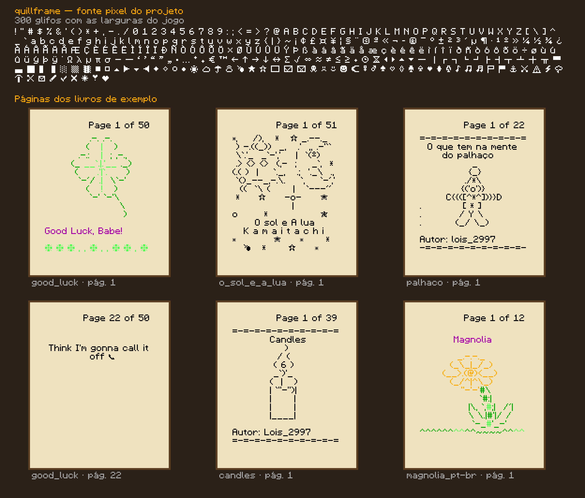

# 05 — Fonte pixel do projeto

> A fonte que o quillframe usa para desenhar os livros. A arte é **própria**, inspirada no estilo das fontes de 8 px dos jogos de blocos (documento 01, D5). Só as **larguras** seguem o Minecraft, porque é delas que depende o alinhamento da arte ASCII (documento 04, §3).



---

## 1. Regras

| Regra | Valor |
|---|---|
| Grade | 8 linhas: 0–6 acima da base, 7 é a descida |
| Maiúsculas e números | linhas 0–6 (7 px) |
| Minúsculas | altura x nas linhas 2–6 (5 px); descida de 1 px (g, j, p, q, y) |
| Largura | **tinta = avanço do jogo − 1**. O espaço entre letras é a coluna vazia que sobra no avanço |
| Acentos das maiúsculas | sobem acima da linha (o desenho ganha linhas extras em cima), como no jogo |
| Cor | a máscara é branca; o site pinta com a cor do texto (§) |

Negrito, itálico, sublinhado, riscado e ofuscado são efeitos do renderizador (documento 04, §6), não glifos separados.

## 2. Cobertura

**300 glifos**, todos de caracteres que o jogo desenha com a fonte bitmap:

- **ASCII** visível (94).
- **Latim-1** completo: acentos do português e outros (`á â ã à ç é ê í ó ô õ ú`, `ª º « » ° § ´`…).
- **Pontuação tipográfica**: `‘ ’ “ ” „ … – — • € ™`.
- **Símbolos**: setas, formas (`▲ ◀ ⏴ ■ ○ ◆`), estrelas (`★ ☆ ⋆`), clima (`☀ ☁ ⛈ ☂ ☃ ☄ ☽ ❄`), rostos e corações (`☺ ☹ ❤ ❣ ♡`), naipes, música (`♪ ♫ ♬`), objetos (`⚔ ⚓ ⛏ ✔ ✘ ☐ ☑ ✎ ✉ ✂ ⌛`), matemática e grego (`∞ ≈ ≠ ≤ √ ∑ π λ σ μ Ω`), desenho de caixas e blocos (`─ │ ┌ ┼ ░ ▒ ▓ █`).

Fica de fora, sem perder o alinhamento:

| Caso | Como aparece |
|---|---|
| Caracteres que o jogo tira da **GNU Unifont** (emojis, `✮ ✯ ☼ ❈ 💔 💋`) | Unifont, que tem licença livre. Em desenvolvimento vem do pacote de referência local. **Pendente**: incluir a Unifont no site publicado, baixada do projeto GNU |
| Outros caracteres bitmap do jogo (cirílico, grego completo, etc.) | caixa do tamanho certo até ganhar desenho |

O teste garante que **todo caractere bitmap usado nos livros do autor** tem desenho.

## 3. Como editar

O arquivo é texto puro: [`assets/pack/font/quillframe-font.txt`](../assets/pack/font/quillframe-font.txt).

```
== A          ← começa um glifo: o caractere, U+XXXX ou @nome (peça)
.###.         ← '#' = pixel, '.' = vazio
#...#
#...#
#####
#...#
#...#
#...#
.....         ← linha 7: descida

á = a + @acute   ← composição: base + acento centralizado em cima
```

- Todas as linhas de um glifo têm a mesma largura. A coluna mais à direita com `#` define a tinta, que precisa ser **avanço do jogo − 1**.
- Peças (`@grave`, `@acute`, `@circumflex`, `@tilde`, `@diaeresis`, `@ring`, `@dotless_i`) são usadas nas composições. O acento fica 1 linha acima da base quando cabe; senão, encosta nela.
- Comentários começam com `//`.

Depois de editar:

```sh
pnpm test            # confere larguras e cobertura
pnpm font:specimen   # atualiza docs/img/fonte-quillframe.png
pnpm dev:web         # Book Viewer → "Font: quillframe"
```

Se uma largura estiver errada, o teste mostra o caractere, a tinta desenhada e a esperada.

## 4. Onde é usada

| Arquivo | O que faz |
|---|---|
| `assets/pack/font/quillframe-font.txt` | desenhos (fonte de verdade) |
| `packages/shared/src/font/pixel-font.ts` | lê o arquivo e monta as composições |
| `packages/shared/test/pixel-font.test.ts` | larguras, cobertura e leitor |
| `apps/web/src/book/glyphs.ts` | `createPackGlyphs`: máscaras para o canvas, Unifont para emojis, caixas para o resto |
| `scripts/font-specimen.mjs` | gera a amostra (`pnpm font:specimen`) |

O "Book Viewer" abre com a fonte do projeto. O botão "Font" alterna entre ela, a fonte do jogo (só com o pacote de referência local) e as caixas.

## 5. Próximos passos

- **WOFF2 para a interface** (documento 03, F5), gerado do mesmo arquivo.
- **Unifont no site publicado**, para emojis e símbolos fora da fonte.
- **Mais glifos** (grego e cirílico completos) conforme os livros pedirem.
