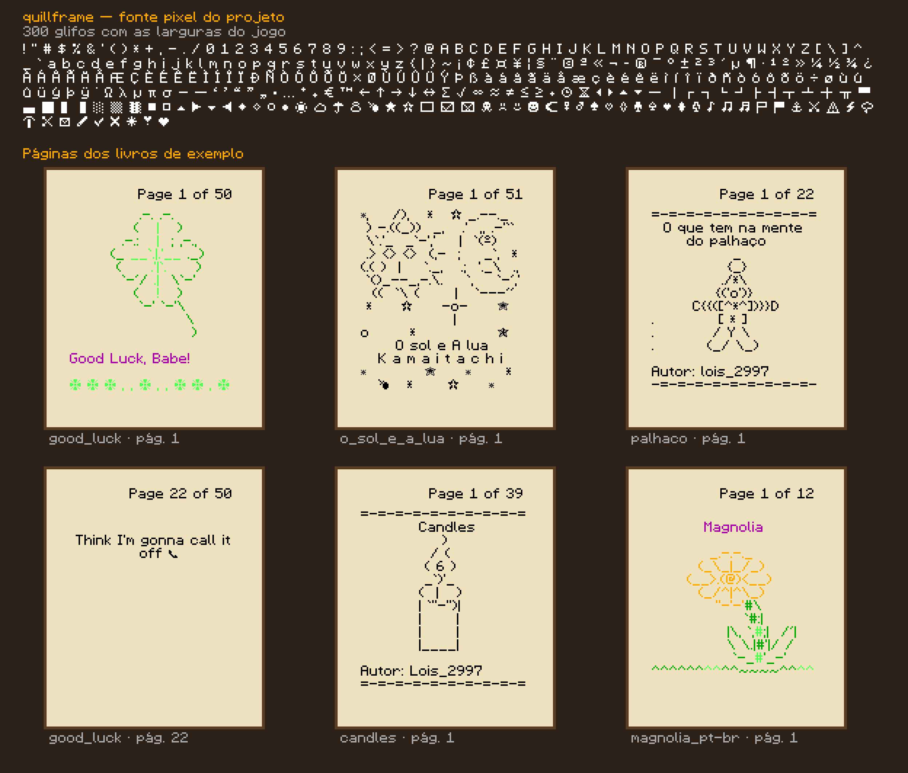

# 05 — Fonte pixel do projeto

> A fonte que o quillframe usa para desenhar os livros. A arte é **própria**, inspirada no estilo das fontes de 8 px dos jogos de blocos (documento 01, D5). Só as **larguras** seguem o Minecraft, porque é delas que depende o alinhamento da arte ASCII (documento 04, §3).



---

## 1. Regras

| Regra | Valor |
|---|---|
| Grade | 8 linhas: 0–6 acima da base, 7 é a descida |
| Maiúsculas e números | linhas 0–6 (7 px) |
| Minúsculas | altura x nas linhas 2–6 (5 px); descida de 1 px (g, j, p, q, y) |
| Largura | **tinta = avanço do jogo − 1**. O espaço entre letras é a coluna vazia que sobra no avanço |
| Acentos das maiúsculas | sobem acima da linha (o desenho ganha linhas extras em cima), como no jogo |
| Cor | a máscara é branca; o site pinta com a cor do texto (§) |

Negrito, itálico, sublinhado, riscado e ofuscado são efeitos do renderizador (documento 04, §6), não glifos separados.

## 2. Cobertura

**300 glifos**, todos de caracteres que o jogo desenha com a fonte bitmap:

- **ASCII** visível (94).
- **Latim-1** completo: acentos do português e outros (`á â ã à ç é ê í ó ô õ ú`, `ª º « » ° § ´`…).
- **Pontuação tipográfica**: `‘ ’ “ ” „ … – — • € ™`.
- **Símbolos**: setas, formas (`▲ ◀ ⏴ ■ ○ ◆`), estrelas (`★ ☆ ⋆`), clima (`☀ ☁ ⛈ ☂ ☃ ☄ ☽ ❄`), rostos e corações (`☺ ☹ ❤ ❣ ♡`), naipes, música (`♪ ♫ ♬`), objetos (`⚔ ⚓ ⛏ ✔ ✘ ☐ ☑ ✎ ✉ ✂ ⌛`), matemática e grego (`∞ ≈ ≠ ≤ √ ∑ π λ σ μ Ω`), desenho de caixas e blocos (`─ │ ┌ ┼ ░ ▒ ▓ █`).

Fica de fora, sem perder o alinhamento:

| Caso | Como aparece |
|---|---|
| Caracteres que o jogo tira da **GNU Unifont** (emojis, `✮ ✯ ☼ ❈ 💔 💋`, CJK) | recorte da GNU Unifont 17.0.01 (licença livre), baixado do projeto GNU (§5) |
| Outros caracteres bitmap do jogo (cirílico, grego completo, etc.) | caixa do tamanho certo até ganhar desenho |

O teste garante que **todo caractere bitmap usado nos livros do autor** tem desenho.

## 3. Como editar

O arquivo é texto puro: [`assets/pack/font/quillframe-font.txt`](../assets/pack/font/quillframe-font.txt).

```
== A          ← começa um glifo: o caractere, U+XXXX ou @nome (peça)
.###.         ← '#' = pixel, '.' = vazio
#...#
#...#
#####
#...#
#...#
#...#
.....         ← linha 7: descida

á = a + @acute   ← composição: base + acento centralizado em cima
```

- Todas as linhas de um glifo têm a mesma largura. A coluna mais à direita com `#` define a tinta, que precisa ser **avanço do jogo − 1**.
- Peças (`@grave`, `@acute`, `@circumflex`, `@tilde`, `@diaeresis`, `@ring`, `@dotless_i`) são usadas nas composições. O acento fica 1 linha acima da base quando cabe; senão, encosta nela.
- Comentários começam com `//`.

Depois de editar:

```sh
pnpm font:web        # gera quillframe.ttf e quillframe.woff2 (fonte da interface, §6)
pnpm test            # confere larguras, cobertura e se o TTF/WOFF2 está em dia
pnpm font:specimen   # atualiza docs/img/fonte-quillframe.png
pnpm dev:web         # Book Viewer → "Font: quillframe"
```

Se uma largura estiver errada, o teste mostra o caractere, a tinta desenhada e a esperada.

## 4. Onde é usada

| Arquivo | O que faz |
|---|---|
| `assets/pack/font/quillframe-font.txt` | desenhos (fonte de verdade) |
| `packages/shared/src/font/pixel-font.ts` | lê o arquivo e monta as composições |
| `packages/shared/test/pixel-font.test.ts` | larguras, cobertura e leitor |
| `apps/web/src/book/glyphs.ts` | `createPackGlyphs`: máscaras para o canvas, recorte da Unifont para emojis, caixas para o resto |
| `assets/pack/font/unifont-common.bin`, `unifont-extra.bin` | recorte da GNU Unifont (§5) |
| `packages/shared/src/font/unifont.ts` | regras de largura da Unifont no jogo e formato do recorte |
| `packages/shared/test/unifont.test.ts` | cada glifo do recorte tem o `left`/`right` que dá o avanço da tabela do jogo |
| `assets/pack/font/quillframe.ttf`, `quillframe.woff2` | fonte da interface (§6) |
| `packages/shared/src/font/pixel-font-ttf.ts` | gera o TTF e o WOFF2 |
| `packages/shared/test/pixel-font-ttf.test.ts` | avanços do TTF e arquivos em dia com o `.txt` |
| `scripts/font-specimen.mjs` | gera a amostra (`pnpm font:specimen`) |

O "Book Viewer" abre com a fonte do projeto. O botão "Font" alterna entre ela, a fonte do jogo (só com o pacote de referência local) e as caixas.

## 5. Unifont

O jogo desenha com a **GNU Unifont** os 112 018 caracteres que a fonte bitmap não tem (emojis, `✮ ☼ ❈`, CJK, hangul...). A Unifont é livre (SIL OFL 1.1, ou GPL com exceção de fonte), então o site usa a mesma, baixada do projeto GNU, sem nada da Mojang.

```sh
pnpm font:unifont    # baixa unifont_all-17.0.01.hex.gz de unifoundry.com e gera o recorte
```

O script (`scripts/unifont-subset.mjs`) pega só os caracteres de tipo `unifont` da tabela de métricas, mede cada um como o jogo (`left`/`right` = primeira e última coluna com pixel, ou os `size_overrides` por bloco, como CJK = 0–15) e **falha se algum avanço não bater com a tabela**. Grava dois arquivos binários com gzip, mais a licença (`UNIFONT-LICENSE.txt`, com a origem e o sha256 do download):

| Arquivo | Conteúdo | Tamanho | Quando carrega |
|---|---|---|---|
| `unifont-common.bin` | símbolos, emojis e escritas do BMP (16 731 glifos) | 156 kB | ao abrir o leitor |
| `unifont-extra.bin` | CJK, hangul, kana, plano 2 em diante (95 287 glifos) | 1 MB | só quando o livro usa algum desses caracteres |

Formato (antes do gzip): `"QFU1"`, os trechos de code points seguidos e, para cada glifo, `left`, `right` e as 16 linhas só com as colunas `left..right` (detalhes em `unifont.ts`). O navegador descomprime com `DecompressionStream`.

Com o pacote de referência local, o teste também compara cada glifo com a Unifont que o jogo usa (a mesma 17.0.01): os desenhos são idênticos, e a amostra gerada com o recorte é igual pixel a pixel à gerada com a do jogo.

## 6. Fonte da interface (WOFF2)

Os botões, títulos e textos da interface usam a fonte do projeto em WOFF2 (documento 03, F5), gerada do mesmo `quillframe-font.txt` por `pnpm font:web` (`scripts/font-web.mjs`):

- cada pixel vira um quadrado de 128 unidades; `unitsPerEm` = 1024 (8 pixels por em);
- o avanço de cada caractere é a largura do jogo; a linha tem 9 pixels (8 acima da base, 1 abaixo);
- glifo ausente: a caixa 5×8 do jogo; o CSS cai na fonte do sistema para caracteres fora da fonte;
- TTF montado à mão e WOFF2 com as mesmas tabelas em Brotli (glyf/loca com a transformação nula), sem dependências.

Os arquivos ficam em `assets/pack/font/` (TTF 46 kB, WOFF2 5 kB), e `apps/web/src/styles/global.css` declara o `@font-face` (`--font-ui` em `tokens.css`). Fica nítida em tamanhos múltiplos de 8 pixels de GUI (`calc(8 * var(--gui))`, 16, 24...). O teste falha se o TTF ou o WOFF2 estiverem desatualizados em relação ao `.txt`.

## 7. Próximos passos

- **Mais glifos** (grego e cirílico completos) conforme os livros pedirem.
- Opção **"Readable Font"** (documento 03, F5), trocando `--font-ui` pela fonte do sistema.
